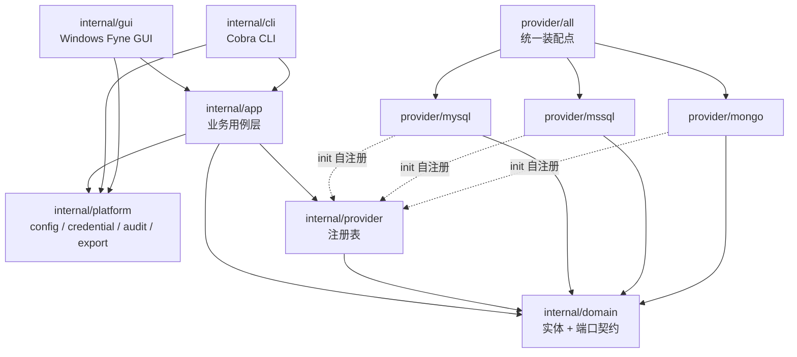

# db-fly 项目设计说明

> 本文档描述 db-fly 的**业务设计**、**架构设计**与**构建命令**，与当前代码库实现保持一致。
> 模块路径：`github.com/db-fly/db-fly`；Go 版本：`go 1.25.0`（见 `go.mod`）。

---

## 1. 业务设计

### 1.1 产品定位

db-fly 是一个**模块化、多数据库、跨平台**的数据库客户端：

| 形态 | 平台 | 入口 | 说明 |
| --- | --- | --- | --- |
| 桌面 GUI | Windows（CGO） | `cmd/db-fly-gui` | Fyne 桌面应用：连接树、结构浏览、SQL 查询、结果网格、数据编辑 |
| 命令行 CLI | Linux / Windows（纯 Go） | `cmd/dbctl` | 连接管理、查询、DDL、导入导出、REPL、历史/收藏 |

两种形态**共用同一套业务内核**（`internal/app`）与**同一份本地配置**，因此连接定义、收藏、查询历史、偏好设置在 GUI 与 CLI 之间共享。

### 1.2 设计目标与约束

1. **按数据库类型垂直隔离**：每种数据库是一个独立 provider 模块，模块之间禁止互相 `import`。
2. **通用层不含方言**：`domain` / `app` / `cli` / `gui` 中不得出现 `switch Kind` 或 SQL 拼接；表现层通过 `CapabilitySet` 能力声明动态决定可用的菜单与流程。
3. **危险操作可预览、可确认**：结构变更与数据回写一律走「结构化编辑 → 方言脚本 → 预览 → 用户显式确认 → 执行」。
4. **安全默认**：密码不落配置文件；写语句默认拒绝；回写一律参数化；只读连接可全局生效。
5. **流式与有界**：结果集流式消费，默认最多 1000 行，避免大结果集撑爆内存。

### 1.3 支持的数据库与能力矩阵

能力由各模块 `capabilitySet()` 声明，通用层只查询 `domain.CapabilitySet`：

| 能力 | MySQL | SQL Server | MongoDB | PostgreSQL | Oracle | SQLite | Redis | 说明 |
| --- | :---: | :---: | :---: | :---: | :---: | :---: | :---: | --- |
| `CapCreateDatabase` | ✔ | ✔ | ✔ | ✔ | ✘ | ✘ | ✘ | Mongo 为创建首个集合隐式建库；SQLite 的「库」是文件 |
| `CapAlterDatabase` | ✔ | ✔ | ✘ | ✔ | ✘ | ✘ | ✘ | |
| `CapCreateTable` | ✔ | ✔ | ✔ | ✔ | ✔ | ✔ | ✔ | Mongo 为创建集合；Redis 语义为创建键 |
| `CapAlterTable` | ✔ | ✔ | ✔ | ✔ | ✔ | ✔ | ✘ | SQLite 不支持 `MODIFY COLUMN` |
| `CapDropObject` | ✔ | ✔ | ✔ | ✔ | ✔ | ✔ | ✔ | |
| `CapIndexes` | ✔ | ✔ | ✔ | ✔ | ✔ | ✔ | ✘ | |
| `CapForeignKeys` | ✔ | ✔ | ✘ | ✔ | ✔ | ✔ | ✘ | |
| `CapSchemas` | ✘ | ✔ | ✘ | ✔ | ✔ | ✘ | ✘ | PG 为 `db.schema.table`；Oracle 的库层级即 schema |
| `CapSQL` | ✔ | ✔ | ✘ | ✔ | ✔ | ✔ | ✘ | |
| `CapMongoFilter` | ✘ | ✘ | ✔ | ✘ | ✘ | ✘ | ✘ | filter / pipeline JSON 查询 |
| `CapKeyValues` | ✘ | ✘ | ✘ | ✘ | ✘ | ✘ | ✔ | Redis 逻辑库 → 键 → 值浏览 |
| `CapJSONTree` | ✘ | ✘ | ✔ | ✘ | ✘ | ✘ | ✘ | 原始 BSON 文档树形展示 |
| `CapExplain` | ✔ | ✔ | ✔ | ✔ | ✔ | ✔ | ✘ | Oracle 走 `EXPLAIN PLAN` + `DBMS_XPLAN`；SQLite 为 `EXPLAIN QUERY PLAN` |
| `CapMultiResult` | ✔ | ✔ | ✘ | ✘ | ✘ | ✘ | ✘ | T-SQL `GO` 批、存储过程多结果集 |
| `CapTransactions` | ✔ | ✔ | ✘ | ✔ | ✔ | ✔ | ✘ | Mongo 一期不提供多文档事务 |
| `CapDataEdit` | ✔ | ✔ | ✔ | ✔ | ✔ | ✔ | ✘ | 结果集编辑回写 |
| `CapTableFilter` | ✔ | ✔ | ✔ | ✔ | ✔ | ✔ | ✘ | 表数据浏览支持 filter / sort |
| `CapShowCreate` | ✔ | ✔ | ✔ | ✔ | ✔ | ✔ | ✔ | 查看建表 SQL（Redis 为等价创建命令） |
| `CapTruncateTable` | ✔ | ✔ | ✘ | ✔ | ✔ | ✔ | ✘ | 生成 `TRUNCATE TABLE` 脚本 |
| `CapEmptyTable` | ✔ | ✔ | ✘ | ✔ | ✔ | ✔ | ✘ | 生成 `DELETE FROM` 脚本 |

### 1.4 功能清单

**连接与元数据**
- 连接配置 CRUD、连通性测试、分组/颜色/只读/超时/TLS/附加参数；类型下拉由 provider 注册中心动态生成。
- 树形浏览：连接 → 数据库 →（SQL Server / PG 的 schema）→ 表/视图/集合；Redis 为连接 → `dbN` → 键。
- 对象详情：字段、索引、外键、建表 DDL / 集合定义 / Redis 键类型与 TTL。

**查询**
- SQL 查询、当前光标所在语句执行、选中文本执行、执行计划、超时与取消。
- MongoDB filter / aggregate pipeline、Extended JSON、集合限定、`explain`、原生数据库命令。
- Redis 原生命令、SCAN 键浏览、string/hash/list/set/zset 值展开、逻辑库切换、只读连接拒绝写命令。
- 表数据浏览支持 filter / sort：关系型为 `WHERE` / `ORDER BY` 片段，MongoDB 为 filter / sort 的 Extended JSON，Redis 的 filter 为键匹配模式。
- 结果集：多结果集页签、列式表格、JSON 文档树、行数上限与截断提示。
- 输出：`table` / `json` / `csv`；CSV 支持多结果集分文件导出。

**结构与脚本**
- 建库 / 改库 / 建表 / 改表 / 删对象的结构化表单 → 方言脚本预览 → 确认执行。
- 「查看建表 SQL」入口展示服务端原始 DDL、元数据反向渲染的 `CREATE TABLE`，或 Redis 等价创建命令；改表表单先展示生成的 ALTER SQL 再确认执行。
- `Script.Format` 区分 `sql`、`mongo_command` 与 `redis_command`；后两者按命令逐条预览（无分号）。
- 自定义脚本执行：SQL 按语句拆分；Mongo 支持命令数组、NDJSON、单个多行 JSON 对象；Redis 按行拆分命令。

**表数据维护**
- 关系型数据库的 `TRUNCATE` 与 `EMPTY(DELETE FROM)`：先确认 → 生成脚本含风险告警 → 只读预览 → 显式确认执行。
- SQLite 无 `TRUNCATE`，用 `DELETE FROM` + 重置 `sqlite_sequence` 达到等效效果。

**数据编辑与导入**
- 结果集单元格行编辑：更新 / 删除 / 复制插入；键列自动推断（主键 → 唯一索引 → `_id`），也允许手动指定。
- 回写由各模块生成参数化 SQL（MySQL `?`、SQL Server `@pN`）或 Mongo 文档命令；支持可选事务。
- 文件导入：SQL 脚本、CSV、TSV、Excel（`.xlsx`/`.xlsm`）、JSON 数组、NDJSON；结构化文件统一转成 `EditInsert` 结构化变更，支持 `--dry-run`、分批、事务。

**辅助能力**
- 查询历史（最近 200 条，可重放）、收藏（名称唯一、跨 GUI/CLI 共享、可直接执行）。
- 结果导出 CSV / JSON、审计日志、主题偏好持久化。

### 1.5 关键业务流程

**结构变更 / 数据回写**

```
表单输入 / 选中结果行
      ↓
结构化对象（TableDefinition / SchemaChange / EditRequest）
      ↓
provider 生成方言脚本（Script / Preview 文本）
      ↓
只读预览 + 警告 + best-effort 回滚提示
      ↓
用户显式确认（CLI: --apply --yes / GUI: 确认按钮）
      ↓
provider 执行（参数化语句 / 数据库命令，可选事务）
      ↓
审计日志 + 查询历史
```

**查询**

```
CLI / GUI → app.Execute / Explain / ExecStatement
      → 校验（只读、语言、超时、最大行数）
      → Session(连接级缓存) → QueryExecutor.Execute
      → 流式 ResultSet（Columns / Next / Row / Document / NextResultSet）
      → consumeResult 分批推送 ResultSink，并施加 MaxRows
      → CLI 渲染 / GUI 页签刷新
```

**导入（结构化文件）**

```
文件解析（CSV / TSV / XLSX / JSON / NDJSON）→ 列名 + 行值
      → RowEdit{EditInsert} → EditRequest（分批）
      → DataEditor.Preview（dry-run）或 Apply → 参数化写入
```

### 1.6 安全设计

- 密码不写入 `config.json`；`secrets.json` 用 Windows DPAPI 或 Linux AES-GCM 加密（密钥来自 `DB_FLY_MASTER_KEY`，兼容旧变量 `DBCLIENT_MASTER_KEY`；未设置时回退机器本地派生密钥）。
- 配置文件权限 `0600`、目录 `0700`；审计日志为 JSONL，语句经 `Sanitize` 脱敏并截断至 1000 字符。
- 只读连接：拒绝写语句、DDL 脚本与数据回写；CLI 写语句需 `--allow-write`，DDL/导入/回写需 `--yes` 二次确认。
- 所有数据回写与导入均不拼接用户值，统一使用参数化语句或文档命令；标识符由各模块做方言转义与合法性校验。

### 1.7 里程碑状态

| 里程碑 | 内容 | 状态 |
| --- | --- | --- |
| M0 | 领域契约、provider 注册、配置/凭证/审计/导出平台层 | 已完成 |
| M1 | MySQL 全链路（连接、元数据、DDL、查询、结果集） | 已完成 |
| M2 | CLI、GUI 骨架、测试与构建校验 | 已完成 |
| M3 | SQL Server：`sys.*` 元数据、`GO` 拆批、多结果集、schema 层级 | 已完成 |
| M4 | MongoDB：集合/索引/validator、find/aggregate、BSON 列式投影 + JSON 树 | 已完成 |
| M5 | 数据编辑回写、SQL/Excel 导入、查询历史与收藏、GUI 多结果集页签 | 已完成 |
| M6 | PostgreSQL / Oracle / SQLite / Redis 模块；表浏览 filter/sort；建表与改表 SQL 预览；TRUNCATE / EMPTY | 已完成 |

---

## 2. 架构设计

### 2.1 分层与依赖方向



**依赖规则**
- `domain` 只依赖标准库，不含任何驱动、方言或 UI 代码。
- `app` 只依赖 `domain` 端口与 `platform` 能力，不感知具体数据库类型。
- 表现层（`cli` / `gui`）只调用 `app` 用例；通过 `CapabilitySet` 决定功能可见性。
- 三个 provider 模块互不依赖，各自通过 `init()` 调用 `provider.Register()` 自注册；`provider/all` 仅做空白导入装配。
- 新增一种数据库 = 新增一个 provider 目录 + 在 `provider/all` 添加一行导入，通用层零改动。

### 2.2 目录结构

```
db-fly/
├── cmd/
│   ├── dbctl/main.go               # CLI 入口（纯 Go，可 CGO_ENABLED=0）
│   └── db-fly-gui/
│       ├── main_windows.go         # //go:build windows && cgo
│       ├── main_stub.go            # //go:build !windows || !cgo
│       ├── notify_windows.go       # //go:build windows，MessageBox + 启动日志
│       └── notify_other.go         # //go:build !windows
├── internal/
│   ├── domain/
│   │   ├── entity.go               # Kind / Capability / 实体与值对象
│   │   ├── port.go                 # Provider / Session / 6 个端口接口
│   │   └── errors.go               # 统一错误码与用户消息
│   ├── app/                        # 用例层（11 个 .go）
│   │   ├── app.go                  # App 聚合、会话缓存、配置串行化锁
│   │   ├── connection.go           # 连接与偏好用例
│   │   ├── metadata.go / schema.go # 元数据浏览、结构脚本预览与执行
│   │   ├── query.go                # 查询、执行、结果流消费 ResultSink
│   │   ├── statements.go           # SQL 拆分、光标语句定位、只读判定
│   │   ├── data.go                 # 数据编辑回写与键列推断
│   │   ├── history.go              # 查询历史、收藏、偏好
│   │   └── import.go               # SQL/CSV/TSV/XLSX/JSON 导入
│   ├── cli/                        # Cobra 命令（10 个 .go）
│   ├── gui/                        # Fyne 桌面（9 个 .go，windows && cgo）
│   ├── platform/
│   │   ├── config/                 # config.json 读写、收藏与历史持久化
│   │   ├── credential/             # DPAPI / AES-GCM 凭证库
│   │   ├── audit/                  # JSONL 审计日志与脱敏
│   │   └── export/                 # CSV / JSON / Table 输出
│   └── provider/
│       ├── registry.go             # Register / Get / Kinds / Capabilities / Open
│       ├── all/all.go              # 三个模块的统一空白导入
│       ├── mysql/  mssql/  mongo/  # 三个垂直业务模块
├── build/
│   ├── cli.sh                      # CLI 构建（Linux/Windows 交叉编译）
│   ├── gui.ps1                     # Windows GUI 构建（需 gcc）
│   └── verify.ps1                  # 一键校验（无需 gcc）
├── go.mod / go.sum
└── project.md                      # 本文档
```

### 2.3 领域契约

`internal/domain/port.go` 定义了全部端口，provider 必须完整实现：

| 端口 | 职责 | 关键方法 |
| --- | --- | --- |
| `Provider` | 模块入口 | `Kind`、`Capabilities`、`Open` |
| `Session` | 连接会话（独立连接池与生命周期） | `ServerInfo`、`Metadata`、`Schema`、`Query`、`Data`、`Close` |
| `MetadataBrowser` | 只读元数据树 | `ListDatabases`、`ListSchemas`、`ListObjects`、`Describe` |
| `SchemaEditor` | 结构变更脚本生成与执行 | `CreateDatabaseScript`、`AlterTableScript`、`ShowCreate`、`Apply` … |
| `QueryExecutor` | 查询与无结果集语句 | `Execute`、`Exec`、`Explain` |
| `ResultSet` | 流式结果集 | `Columns`、`Next`、`Row`、`Document`、`NextResultSet`、`Close` |
| `DataEditor` | 结果集数据回写 | `Preview`、`Apply` |
| `TableMaintenance`（可选） | 清空表数据脚本 | `TableActionScript`；不支持的模块返回 `nil` |

核心实体（`entity.go`）：`ConnectionConfig`、`Script`（含 `Database` 用于按库分池）、`Query`（含 `Filter` / `Sort`）、`ResultPage`、`QueryOutcome`、`EditRequest` / `RowEdit` / `EditResult`、`TableSchema` / `ColumnSpec` / `SchemaChange`、`TableAction` 等。

`Query.Ref` 非空且 `Text` 为空时表示「预览该对象的数据」，由各 provider 自行生成方言语句（MySQL `LIMIT`、SQL Server `SELECT TOP`、Oracle `FETCH FIRST`、Mongo 空 filter），通用层不拼 SQL；`Filter` / `Sort` 的语义由模块自行解释。

关系型模块共用 `internal/provider/sqlkit`（非数据库模块）：标识符引用、片段安全校验、通用流式/内存结果集、filter/sort 解析、参数化数据编辑、DDL 脚本装配与 `ScriptRunner`；PostgreSQL 通过 `PoolSet` 按库懒建连接池。

### 2.4 会话与连接管理

- `App.Session(ctx, nameOrID)` 以 `ConnectionConfig.ID` 为键缓存会话，双检锁避免重复建连；配置变更或删除连接时 `DropSession` 失效并关闭。
- 每个 `Session` 持有独立 `*sql.DB`（关系型）或 `*mongo.Client`（文档型），互不共享连接池。
- `USE` / 数据库上下文绑定到独占的 `*sql.Conn`，并把该连接的生命周期绑定到结果集（`ResultSet.Close` 时归还），避免连接池导致的上下文串库。
- 查询超时由 `context.WithTimeout` 施加；GUI 支持取消；结果集消费完或取消 context 后关闭。

### 2.5 各 provider 的方言落点

| 模块 | 元数据 | 脚本/DDL | 查询 | 结果集 | 数据回写 |
| --- | --- | --- | --- | --- | --- |
| `mysql` | `information_schema` | 反引号标识符、DDL 事务性提示 | `EXPLAIN`、`?` 占位符 | 单/多结果集 | `?` 参数化 `UPDATE/DELETE/INSERT` |
| `mssql` | `sys.*` 三层视图 | `[ident]` 方括号、`GO` 客户端拆批 | `SET SHOWPLAN_ALL`、批内多结果集 | `batchResultSet` 跨批切换 | `@pN` 命名参数 + `sql.Named` |
| `mongo` | `ListDatabaseNames` / `ListCollectionNames` / 采样推断 | `mongo_command` JSON 命令、`$jsonSchema`、`collMod` / `createIndexes` | find / aggregate / explain / RunCommand | 前 50 文档采样生成列式投影 + 原始 JSON 文档 | `updateOne` / `deleteOne` / `insertOne` |

`Script.Format` 为 `mongo_command` 时，`Statements` 是 JSON 命令文本；CLI 与 GUI 的脚本预览据此切换注释风格与展示格式。

### 2.6 结果流与表现层

- `app.ResultSink`：`OnResultStart(index, cols)` / `OnRows(index, rows)` / `OnFinish(outcome)`；CLI 用 `CollectSink` 累积，GUI 用 `gridSink` 经 `fyne.Do` 切回 UI 线程分批刷新。
- `consumeResult` 循环 `NextResultSet()` 生成多个 `ResultPage`，每批 200 行推送，施加 `MaxRows` 并标记 `Truncated`；同时收集 `ResultSet.Document()` 为 `JSONDocuments`。
- GUI `resultGrid` 为每个结果集生成一个 `container.AppTabs` 页签，含 BSON 文档的结果集额外生成 `widget.Tree` JSON 树页签。

### 2.7 错误处理与审计

- `domain.Error` 携带 `ErrorCode`（`CodeValidation` / `CodeAuthFailed` / `CodeConnection` / `CodeQuery` / `CodeReadOnly` / `CodeUnsupported` / `CodeCanceled` / `CodeTimeout` …）、操作名与用户可读消息。
- 各 provider 用 `mapOpenError` / `mapQueryError` 把驱动错误映射为领域错误，CLI 统一通过 `domain.UserMessage` 输出。
- `app` 在 connect / query / explain / exec / apply_script / data_edit / import / save_connection 等节点写审计日志。

### 2.8 本地数据

默认数据目录 `~/.db-fly`，CLI 可用全局 `--data-dir` 覆盖。兼容升级：若 `~/.db-fly` 不存在而旧版 `~/.dbclient` 存在，程序会自动沿用旧目录，已有连接与凭证不会丢失：

| 文件 | 内容 | 权限 |
| --- | --- | --- |
| `config.json` | 连接定义、偏好、收藏、查询历史（**不含密码**） | `0600` |
| `secrets.json` | 加密的连接密码 | `0600` |
| `audit.log` | JSONL 审计记录（脱敏） | `0600` |
| `credential.salt` | 非 Windows 平台密钥派生盐 | — |

### 2.9 构建标签与跨平台策略

| 文件 | 构建标签 | 作用 |
| --- | --- | --- |
| `internal/gui/*.go`（`stub.go` 除外） | `//go:build windows && cgo` | 真实 Fyne GUI |
| `internal/gui/stub.go` | `//go:build !windows \|\| !cgo` | 无 GUI 环境下 `Run()` 返回提示错误 |
| `cmd/db-fly-gui/main_windows.go` | `//go:build windows && cgo` | GUI 入口 |
| `cmd/db-fly-gui/main_stub.go` | `//go:build !windows \|\| !cgo` | 占位入口（Windows 下弹窗提示需要 CGO/gcc） |
| `cmd/db-fly-gui/notify_windows.go` | `//go:build windows` | 无控制台时 MessageBox 提示、启动日志与 panic 兜底 |
| `cmd/db-fly-gui/notify_other.go` | `//go:build !windows` | 非 Windows 空实现 |
| `internal/provider/mysql/integration_test.go` | `//go:build integration` | 需真实 MySQL 的集成测试 |

CLI 与全部非 GUI 代码均为纯 Go，可在 Linux 下 `CGO_ENABLED=0` 静态编译。无 gcc 的 Windows 环境通过 `go build -tags "ci cgo" ./...` 使用 Fyne 的 `ci`（headless）标签仅做 GUI 类型检查，不产出可执行 GUI。

### 2.10 直接依赖

| 依赖 | 版本 | 用途 |
| --- | --- | --- |
| `fyne.io/fyne/v2` | v2.6.3 | Windows GUI |
| `github.com/spf13/cobra` | v1.10.2 | CLI 命令树 |
| `github.com/go-sql-driver/mysql` | v1.10.1 | MySQL 驱动 |
| `github.com/microsoft/go-mssqldb` | v1.11.2 | SQL Server 驱动 |
| `go.mongodb.org/mongo-driver/v2` | v2.10.0 | MongoDB 驱动 |
| `github.com/jackc/pgx/v5` | v5.7.6 | PostgreSQL 驱动（纯 Go，无 CGO） |
| `github.com/sijms/go-ora/v2` | v2.9.0 | Oracle 驱动（纯 Go，无需 Instant Client） |
| `modernc.org/sqlite` | v1.38.2 | SQLite 驱动（纯 Go，无 CGO） |
| `github.com/redis/go-redis/v9` | v9.14.0 | Redis 客户端 |
| `github.com/xuri/excelize/v2` | v2.9.1 | Excel 导入 |

---

## 3. 构建命令

以下命令均在仓库根目录执行。

### 3.1 环境要求

| 目标 | 要求 |
| --- | --- |
| 全部 | Go 1.25.0+ |
| CLI | 无额外依赖（纯 Go，`CGO_ENABLED=0`） |
| GUI 可执行文件 | Windows + mingw-w64 gcc（Fyne 需要 CGO / OpenGL 工具链） |
| 一键校验 | 无需 gcc，PowerShell（Windows） |

### 3.2 一键校验（推荐，无需 gcc）

```powershell
# Windows PowerShell
./build/verify.ps1
```

等价的逐步命令：

```powershell
$env:CGO_ENABLED = "0"
gofmt -l ./cmd ./internal                 # 输出为空即通过
go build ./...                            # 默认构建（不含 GUI 实现）
go build -tags "ci cgo" ./...             # GUI 无头类型检查
go vet ./...
go test ./...
```

> `gofmt` 只检查 `./cmd ./internal`，避免扫描 IDE 生成的 `pkg/` 模块缓存副本。

### 3.3 构建 CLI

**Linux / macOS（或 Windows 的 Git Bash）**

```bash
bash build/cli.sh
# 默认：CGO_ENABLED=0 GOOS=linux GOARCH=amd64 → dist/dbctl，Version=dev

VERSION=v1.0.0 bash build/cli.sh
GOOS_TARGET=windows GOARCH_TARGET=amd64 OUTPUT=dist/dbctl.exe VERSION=v1.0.0 bash build/cli.sh
```

`build/cli.sh` 实际执行：

```bash
CGO_ENABLED=0 GOOS="$GOOS_TARGET" GOARCH="$GOARCH_TARGET" \
  go build -trimpath \
  -ldflags "-s -w -X github.com/db-fly/db-fly/internal/cli.Version=${VERSION}" \
  -o "$OUTPUT" ./cmd/dbctl
```

**Windows PowerShell 直接构建**

```powershell
$env:CGO_ENABLED = "0"
go build -trimpath -ldflags "-s -w -X github.com/db-fly/db-fly/internal/cli.Version=dev" -o dist/dbctl.exe ./cmd/dbctl
```

**不产出文件的快速编译检查**

```powershell
go build ./...
```

### 3.4 构建 Windows GUI

```powershell
./build/gui.ps1
```

脚本会自动探测 `gcc`（PATH 或 MSYS2 / TDM-GCC / scoop 常见安装路径）、强制 `CGO_ENABLED=1`，并在构建后用 `go version -m` 校验产物确实含 `CGO_ENABLED=1`；不满足时删除产物并报错，避免生成双击无反应的占位程序。

手动直接构建时**必须先设置 CGO 环境**，否则 `cmd/db-fly-gui/main_stub.go` 会被编译进去：

```powershell
$env:CGO_ENABLED = "1"
$env:PATH = "C:\msys64\ucrt64\bin;$env:PATH"   # mingw-w64 gcc 所在目录
go build -trimpath -ldflags "-s -w -H windowsgui" -o dist/db-fly-gui.exe ./cmd/db-fly-gui
```

> `go env CGO_ENABLED` 在没有 C 编译器时默认为 `0`：真实 GUI 文件（`windows && cgo`）被排除，产物只是打印一行提示就退出的占位程序；`-H windowsgui` 又不分配控制台，因此双击表现为「打不开」。
> `-X ...internal/cli.Version` 只适用于 `dbctl`（GUI 未链接 `internal/cli`，注入会被链接器忽略），GUI 构建不需要该参数；版本注入见 `build/cli.sh`。
> `-H windowsgui` 使 GUI 程序不弹出控制台窗口；启动错误由 `cmd/db-fly-gui/notify_windows.go` 写入 `%TEMP%\db-fly\gui-startup.log` 并通过 MessageBox 提示。若需要带图标的安装包，可用 `fyne package` 进一步打包。
> 无 gcc 时只能执行 `go build -tags "ci cgo" ./...` 做类型检查，不能产出 `db-fly-gui.exe`。
> 用其他 gcc 构建时若双击报缺少 `libwinpthread-1.dll` 等依赖，可把该 DLL 复制到 `dist/`，或追加 `-ldflags "-linkmode external -extldflags=-static"` 静态链接。

### 3.5 测试

```powershell
go test ./...                                     # 全量单元测试
go test ./internal/app -run TestImport -v         # 按用例过滤
go vet ./...                                      # 静态检查
```

**集成测试**（需真实 MySQL，未设置 DSN 时自动跳过）：

```bash
MYSQL_DSN='root:pass@tcp(127.0.0.1:3306)/' go test -tags integration ./internal/provider/mysql -v
```

### 3.6 依赖管理

```powershell
go mod download
go mod tidy
```

### 3.7 CLI 命令速查

全局参数：`--data-dir <目录>`（默认 `~/.db-fly`）。

```bash
# 连接（--port 省略时按 --kind 取默认端口；SQLite 的 --host 是文件路径）
dbctl conn add --name dev --kind mysql --host 127.0.0.1 --user root
dbctl conn add --name pg --kind postgresql --host 127.0.0.1 --user postgres --database appdb
dbctl conn add --name ora --kind oracle --host 127.0.0.1 --user scott --params service=XEPDB1
dbctl conn add --name lite --kind sqlite --host D:/data/app.db
dbctl conn add --name cache --kind redis --host 127.0.0.1 --database db0
dbctl conn list
dbctl conn test dev
dbctl conn rm dev

# 查询（SQL / MongoDB / Redis）
dbctl query --conn dev --sql "SELECT * FROM db.t" --format table
dbctl query --conn dev --sql '{"status":"A"}' --language mongo_filter --collection orders
dbctl query --conn cache --sql "SCAN 0 MATCH user:* COUNT 100" --language redis
dbctl query --conn dev --file script.sql --format csv --output result.csv
dbctl query --conn dev --sql "SELECT 1" --save daily
dbctl query --conn dev --sql "UPDATE t SET a=1" --allow-write

# 表数据浏览（filter / sort）与清空表数据
dbctl data browse --conn dev --database db --table t --filter "age > 18" --sort "id DESC"
dbctl data browse --conn dev --collection orders --filter '{"age":{"$gt":18}}' --sort '{"age":-1}'
dbctl data browse --conn cache --database db0 --filter "user:*"
dbctl data truncate --conn dev --database db --table t            # 仅预览
dbctl data truncate --conn dev --database db --table t --apply --yes
dbctl data empty --conn dev --database db --table t --apply --yes

# 结构与脚本
dbctl db list --conn dev
dbctl schema show --conn dev --database db --table t
dbctl schema ddl --conn dev --database db --table t
dbctl schema create-table --conn dev --def table.json --apply --yes
dbctl schema apply --conn dev --file commands.json --format mongo_command
dbctl schema apply --conn cache --file commands.redis --format redis_command

# 数据编辑与导入
dbctl edit keys --conn dev --database db --table t
dbctl edit preview --conn dev --file edits.json
dbctl edit apply --conn dev --file edits.json --yes
dbctl import --conn dev --file rows.csv --database db --table t --dry-run
dbctl import --conn dev --file rows.xlsx --database db --table t --sheet Sheet1 --yes

# 历史与收藏
dbctl history list --limit 30
dbctl history clear
dbctl favorite add --name daily --conn dev --sql "SELECT 1"
dbctl favorite list --format json
dbctl favorite run daily
dbctl favorite remove daily

# 交互式终端（SQL 以分号结束；Mongo JSON 以空行结束）
dbctl repl --conn dev
dbctl repl --conn dev --language filter --collection orders

# 运行环境
dbctl info
```

### 3.8 常用环境变量

| 变量 | 用途 |
| --- | --- |
| `VERSION` | `build/cli.sh` 注入的版本号（写入 `internal/cli.Version`，仅 CLI 使用；GUI 不链接该包） |
| `GOOS_TARGET` / `GOARCH_TARGET` / `OUTPUT` | `build/cli.sh` 的交叉编译目标与输出路径 |
| `DB_FLY_MASTER_KEY` | Linux 下凭证加密主密钥（兼容旧变量 `DBCLIENT_MASTER_KEY`）；未设置时使用机器本地派生密钥并打印告警 |
| `MYSQL_DSN` | MySQL 集成测试 DSN |

---

## 4. 扩展指引

新增一种数据库类型（参考 `internal/provider/postgres/` 与 `internal/provider/sqlite/`）：

1. 在 `internal/domain/entity.go` 的 `Kind` 常量与 `AllKinds()` / `Valid()` / `DefaultPort()` 中登记；文件型数据库实现 `IsFileBased()`，关系型登记 `IsRelational()`。
2. 新建 `internal/provider/<name>/`，实现 `domain.Provider` 与端口契约（`MetadataBrowser`、`SchemaEditor`、`QueryExecutor`、`DataEditor`、`Session`），声明 `capabilitySet()`，在 `init()` 中调用 `provider.Register()`。需要清空表能力时额外实现 `Session.Maintenance() domain.TableMaintenance`，否则返回 `nil`。
3. 关系型模块优先复用 `internal/provider/sqlkit`：`BuildPreview` 负责 filter/sort 与分页，`Editor` 负责参数化回写，`Schema` + `ScriptRunner` 负责 DDL 脚本装配；只需实现方言元数据查询与 `DDLDriver`。
4. 在 `internal/provider/all/all.go` 添加一行空白导入；GUI 连接类型下拉、CLI 默认端口与语言选择均由注册中心与能力声明驱动。
5. 补充该模块的纯函数单元测试（可参照 SQLite 端到端测试），并执行 `./build/verify.ps1`。
