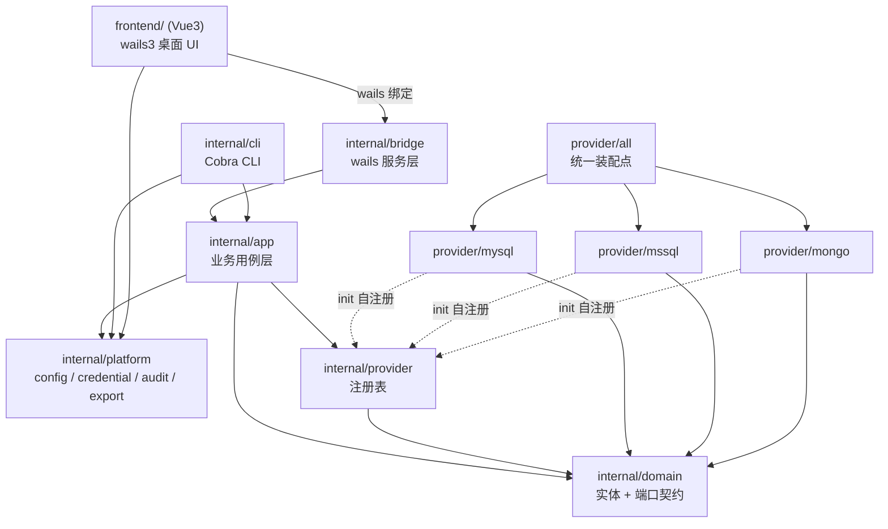
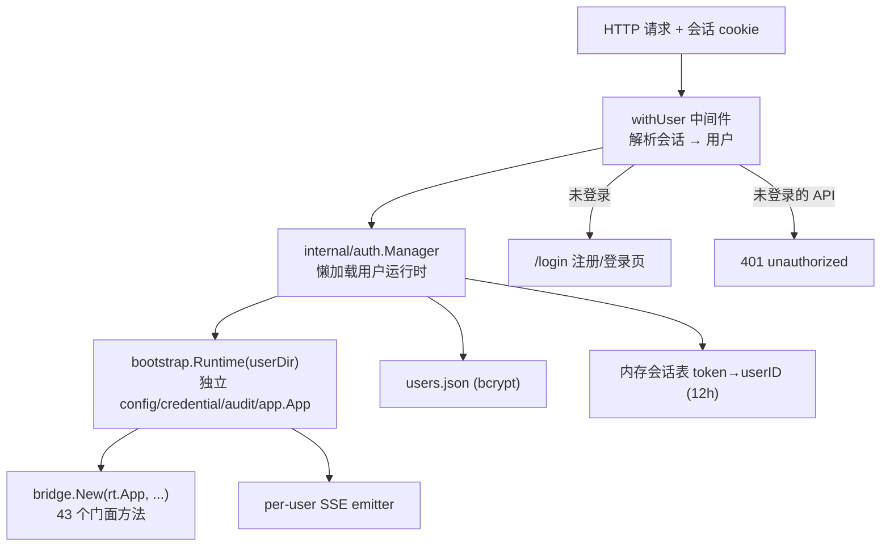

# db-fly 项目设计说明

> 本文档描述 db-fly 的**业务设计**、**架构设计**与**构建命令**，与当前代码库实现保持一致。
> 模块路径：`github.com/db-fly/db-fly`；Go 版本：`go 1.26.0`（见 `go.mod`）。

---

## 1. 业务设计

### 1.1 产品定位

db-fly 是一个**模块化、多数据库、跨平台**的数据库客户端：

| 形态 | 平台 | 入口 | 说明 |
| --- | --- | --- | --- |
| 桌面 GUI | Windows（纯 Go wails3 + WebView2） | `cmd/db-fly-gui` + `frontend/` | wails3 + Vue3 桌面应用：连接树、结构浏览、SQL 查询、结果网格、数据编辑 |
| 命令行 CLI | Linux / Windows（纯 Go） | `cmd/dbctl` | 连接管理、查询、DDL、导入导出、REPL、历史/收藏 |

两种形态**共用同一套业务内核**（`internal/app`）与**同一份本地配置**，因此连接定义、收藏、查询历史、偏好设置在 GUI 与 CLI 之间共享。

### 1.2 设计目标与约束

1. **按数据库类型垂直隔离**：每种数据库是一个独立 provider 模块，模块之间禁止互相 `import`。
2. **通用层不含方言**：`domain` / `app` / `cli` / `gui` 中不得出现 `switch Kind` 或 SQL 拼接；表现层通过 `CapabilitySet` 能力声明动态决定可用的菜单与流程。
3. **危险操作可预览、可确认**：结构变更与数据回写一律走「结构化编辑 → 方言脚本 → 预览 → 用户显式确认 → 执行」。
4. **安全默认**：密码不落配置文件；写语句默认拒绝；回写一律参数化；只读连接可全局生效。
5. **流式与有界**：结果集流式消费，默认最多 1000 行，避免大结果集撑爆内存。

### 1.3 支持的数据库与能力矩阵

能力由各模块 `capabilitySet()` 声明，通用层只查询 `domain.CapabilitySet`：

| 能力 | MySQL | SQL Server | MongoDB | PostgreSQL | Oracle | SQLite | Redis | 说明 |
| --- | :---: | :---: | :---: | :---: | :---: | :---: | :---: | --- |
| `CapCreateDatabase` | ✔ | ✔ | ✔ | ✔ | ✘ | ✘ | ✘ | Mongo 为创建首个集合隐式建库；SQLite 的「库」是文件 |
| `CapAlterDatabase` | ✔ | ✔ | ✘ | ✔ | ✘ | ✘ | ✘ | |
| `CapCreateTable` | ✔ | ✔ | ✔ | ✔ | ✔ | ✔ | ✔ | Mongo 为创建集合；Redis 语义为创建键 |
| `CapAlterTable` | ✔ | ✔ | ✔ | ✔ | ✔ | ✔ | ✘ | SQLite 不支持 `MODIFY COLUMN` |
| `CapDropObject` | ✔ | ✔ | ✔ | ✔ | ✔ | ✔ | ✔ | |
| `CapIndexes` | ✔ | ✔ | ✔ | ✔ | ✔ | ✔ | ✘ | |
| `CapForeignKeys` | ✔ | ✔ | ✘ | ✔ | ✔ | ✔ | ✘ | |
| `CapSchemas` | ✘ | ✔ | ✘ | ✔ | ✔ | ✘ | ✘ | PG 为 `db.schema.table`；Oracle 的库层级即 schema |
| `CapSQL` | ✔ | ✔ | ✘ | ✔ | ✔ | ✔ | ✘ | |
| `CapMongoFilter` | ✘ | ✘ | ✔ | ✘ | ✘ | ✘ | ✘ | filter / pipeline JSON 查询 |
| `CapKeyValues` | ✘ | ✘ | ✘ | ✘ | ✘ | ✘ | ✔ | Redis 逻辑库 → 键 → 值浏览 |
| `CapJSONTree` | ✘ | ✘ | ✔ | ✘ | ✘ | ✘ | ✘ | 原始 BSON 文档树形展示 |
| `CapExplain` | ✔ | ✔ | ✔ | ✔ | ✔ | ✔ | ✘ | Oracle 走 `EXPLAIN PLAN` + `DBMS_XPLAN`；SQLite 为 `EXPLAIN QUERY PLAN` |
| `CapMultiResult` | ✔ | ✔ | ✘ | ✘ | ✘ | ✘ | ✘ | T-SQL `GO` 批、存储过程多结果集 |
| `CapTransactions` | ✔ | ✔ | ✘ | ✔ | ✔ | ✔ | ✘ | Mongo 一期不提供多文档事务 |
| `CapDataEdit` | ✔ | ✔ | ✔ | ✔ | ✔ | ✔ | ✘ | 结果集编辑回写 |
| `CapTableFilter` | ✔ | ✔ | ✔ | ✔ | ✔ | ✔ | ✘ | 表数据浏览支持 filter / sort |
| `CapShowCreate` | ✔ | ✔ | ✔ | ✔ | ✔ | ✔ | ✔ | 查看建表 SQL（Redis 为等价创建命令） |
| `CapTruncateTable` | ✔ | ✔ | ✘ | ✔ | ✔ | ✔ | ✘ | 生成 `TRUNCATE TABLE` 脚本 |
| `CapEmptyTable` | ✔ | ✔ | ✘ | ✔ | ✔ | ✔ | ✘ | 生成 `DELETE FROM` 脚本 |

### 1.4 功能清单

**连接与元数据**
- 连接配置 CRUD、连通性测试、分组/颜色/只读/超时/TLS/附加参数；类型下拉由 provider 注册中心动态生成。
- 树形浏览：连接 → 数据库 →（SQL Server / PG 的 schema）→ 表/视图/集合；Redis 为连接 → `dbN` → 键。
- 对象详情：字段、索引、外键、建表 DDL / 集合定义 / Redis 键类型与 TTL。

**查询**
- SQL 查询、当前光标所在语句执行、选中文本执行、执行计划、超时与取消。
- MongoDB filter / aggregate pipeline、Extended JSON、集合限定、`explain`、原生数据库命令。
- Redis 原生命令、SCAN 键浏览、string/hash/list/set/zset 值展开、逻辑库切换、只读连接拒绝写命令。
- 表数据浏览支持 filter / sort：关系型为 `WHERE` / `ORDER BY` 片段，MongoDB 为 filter / sort 的 Extended JSON，Redis 的 filter 为键匹配模式。
- 关系型 GUI 另提供结构化「过滤 / 排序」构建器：多条字段条件（含 AND/OR 连接词与操作符白名单）、多条升序/降序排序项，`Query.Conditions` / `Query.OrderTerms` 由 `sqlkit` 按方言引用标识符、转义字面量；`Query.Offset` 驱动五种方言的分页（MySQL/PG/SQLite `LIMIT n OFFSET m`、SQL Server `OFFSET m ROWS FETCH NEXT n ROWS ONLY`、Oracle 同 ANSI 分页）。
- 结果集：多结果集页签、列式表格、JSON 文档树、行数上限与截断提示。
- 输出：`table` / `json` / `csv`；CSV 支持多结果集分文件导出。

**结构与脚本**
- 建库 / 改库 / 建表 / 改表 / 删对象的结构化表单 → 方言脚本预览 → 确认执行。
- 「查看建表 SQL」入口展示服务端原始 DDL、元数据反向渲染的 `CREATE TABLE`，或 Redis 等价创建命令；改表表单先展示生成的 ALTER SQL 再确认执行。
- 新建表在**独立可关闭页签**中打开（不再是弹窗），使用与「表结构」页一致的表结构样式设计器：字段网格 + 逐行属性表单 + 索引页 + 表选项页，不再编辑 JSON；最终仍组装 `TableDefinition` 交给数据库模块生成方言脚本。
- 重命名表 / 集合：`PreviewRenameTable` 由各模块生成方言脚本（MySQL `RENAME TABLE`、SQL Server `sp_rename`、PG/SQLite `ALTER TABLE ... RENAME TO`、Oracle `RENAME`、Mongo `renameCollection`），同样先预览再确认执行。
- `Script.Format` 区分 `sql`、`mongo_command` 与 `redis_command`；后两者按命令逐条预览（无分号）。
- 自定义脚本执行：SQL 按语句拆分；Mongo 支持命令数组、NDJSON、单个多行 JSON 对象；Redis 按行拆分命令。

**表数据维护**
- 关系型数据库的 `TRUNCATE` 与 `EMPTY(DELETE FROM)`：先确认 → 生成脚本含风险告警 → 只读预览 → 显式确认执行。
- SQLite 无 `TRUNCATE`，用 `DELETE FROM` + 重置 `sqlite_sequence` 达到等效效果。

**数据编辑与导入**
- 结果集单元格行编辑：更新 / 删除 / 复制插入；键列自动推断（主键 → 唯一索引 → `_id`），也允许手动指定。
- 关系型表数据页支持**原单元格内联编辑**：`editableCell` 模板接管单元格单击，在网格内直接展开输入框（回车或切换单元格即暂存）；底部记录操作条提供 `+ 新增记录 / − 删除记录 / ✕ 取消编辑 / 提交 / 回退`，新增记录以空白虚拟行追加在网格末尾并同样逐格内联填写。提交时把「单元格修改 + 删除标记 + 新增行」合并为一次 `EditRequest`（先预览参数化语句再确认回写），回退丢弃全部未提交改动。
- 回写由各模块生成参数化 SQL（MySQL `?`、SQL Server `@pN`）或 Mongo 文档命令；支持可选事务。
- 文件导入：SQL 脚本、CSV、TSV、Excel（`.xlsx`/`.xlsm`）、JSON 数组、NDJSON；结构化文件统一转成 `EditInsert` 结构化变更，支持 `--dry-run`、分批、事务。

**辅助能力**
- 查询历史（最近 200 条，可重放）、收藏（名称唯一、跨 GUI/CLI 共享、可直接执行）。
- 结果导出 CSV / JSON、审计日志、主题偏好持久化。

### 1.5 关键业务流程

**结构变更 / 数据回写**

```
表单输入 / 选中结果行
      ↓
结构化对象（TableDefinition / SchemaChange / EditRequest）
      ↓
provider 生成方言脚本（Script / Preview 文本）
      ↓
只读预览 + 警告 + best-effort 回滚提示
      ↓
用户显式确认（CLI: --apply --yes / GUI: 确认按钮）
      ↓
provider 执行（参数化语句 / 数据库命令，可选事务）
      ↓
审计日志 + 查询历史
```

**查询**

```
CLI / GUI → app.Execute / Explain / ExecStatement
      → 校验（只读、语言、超时、最大行数）
      → Session(连接级缓存) → QueryExecutor.Execute
      → 流式 ResultSet（Columns / Next / Row / Document / NextResultSet）
      → consumeResult 分批推送 ResultSink，并施加 MaxRows
      → CLI 渲染 / GUI 页签刷新
```

**导入（结构化文件）**

```
文件解析（CSV / TSV / XLSX / JSON / NDJSON）→ 列名 + 行值
      → RowEdit{EditInsert} → EditRequest（分批）
      → DataEditor.Preview（dry-run）或 Apply → 参数化写入
```

### 1.6 安全设计

- 密码不写入 `config.json`；`secrets.json` 用 Windows DPAPI 或 Linux AES-GCM 加密（密钥来自 `DB_FLY_MASTER_KEY`，兼容旧变量 `DBCLIENT_MASTER_KEY`；未设置时回退机器本地派生密钥）。
- 配置文件权限 `0600`、目录 `0700`；审计日志为 JSONL，语句经 `Sanitize` 脱敏并截断至 1000 字符。
- 只读连接：拒绝写语句、DDL 脚本与数据回写；CLI 写语句需 `--allow-write`，DDL/导入/回写需 `--yes` 二次确认。
- 所有数据回写与导入均不拼接用户值，统一使用参数化语句或文档命令；标识符由各模块做方言转义与合法性校验。

### 1.7 里程碑状态

| 里程碑 | 内容 | 状态 |
| --- | --- | --- |
| M0 | 领域契约、provider 注册、配置/凭证/审计/导出平台层 | 已完成 |
| M1 | MySQL 全链路（连接、元数据、DDL、查询、结果集） | 已完成 |
| M2 | CLI、GUI 骨架、测试与构建校验 | 已完成 |
| M3 | SQL Server：`sys.*` 元数据、`GO` 拆批、多结果集、schema 层级 | 已完成 |
| M4 | MongoDB：集合/索引/validator、find/aggregate、BSON 列式投影 + JSON 树 | 已完成 |
| M5 | 数据编辑回写、SQL/Excel 导入、查询历史与收藏、GUI 多结果集页签 | 已完成 |
| M6 | PostgreSQL / Oracle / SQLite / Redis 模块；表浏览 filter/sort；建表与改表 SQL 预览；TRUNCATE / EMPTY | 已完成 |

---

## 2. 架构设计

### 2.1 分层与依赖方向



**依赖规则**
- `domain` 只依赖标准库，不含任何驱动、方言或 UI 代码。
- `app` 只依赖 `domain` 端口与 `platform` 能力，不感知具体数据库类型。
- 表现层（`cli` / `gui`）只调用 `app` 用例；通过 `CapabilitySet` 决定功能可见性。
- 三个 provider 模块互不依赖，各自通过 `init()` 调用 `provider.Register()` 自注册；`provider/all` 仅做空白导入装配。
- 新增一种数据库 = 新增一个 provider 目录 + 在 `provider/all` 添加一行导入，通用层零改动。

### 2.2 目录结构

```
db-fly/
├── logo.png                        # 应用图标唯一来源（生成 .ico / .syso / 前端 favicon）
├── Taskfile.yml                    # wails3 build/package 的任务入口（转发到 build/gui.ps1）
├── build/
│   ├── gui.ps1                     # Windows GUI 一键构建（前端 + 图标 + 纯 Go 编译）
│   └── windows/
│       ├── icon.ico                # 由 logo.png 生成的多尺寸 Windows 图标
│       ├── wails.exe.manifest      # DPI/Common-Controls 清单
│       └── info.json               # exe 版本信息
├── frontend/public/logo.png        # 窗口内 favicon（logo.png 的副本）
├── cmd/
│   ├── dbctl/main.go               # CLI 入口（纯 Go，可 CGO_ENABLED=0）
│   └── db-fly-gui/
│       ├── main.go                 # //go:build windows，wails3 入口（纯 Go，嵌入前端、注册 Bridge 服务）
│       ├── stub.go                 # //go:build !windows，非 Windows 平台占位入口
│       ├── icon.png                # logo.png 副本，//go:embed 供 Options.Icon（Linux/macOS）
│       ├── rsrc_windows_*.syso     # 由 wails3 generate syso 生成，链接进 exe 作为文件/任务栏图标
│       └── assets/                 # 由 build/gui.ps1 从 frontend/dist 复制的 Vue 构建产物（//go:embed all:assets）
├── internal/
│   ├── domain/
│   │   ├── entity.go               # Kind / Capability / 实体与值对象
│   │   ├── port.go                 # Provider / Session / 6 个端口接口
│   │   └── errors.go               # 统一错误码与用户消息
│   ├── app/                        # 用例层（11 个 .go）
│   │   ├── app.go                  # App 聚合、会话缓存、配置串行化锁
│   │   ├── connection.go           # 连接与偏好用例
│   │   ├── metadata.go / schema.go # 元数据浏览、结构脚本预览与执行
│   │   ├── query.go                # 查询、执行、结果流消费 ResultSink
│   │   ├── statements.go           # SQL 拆分、光标语句定位、只读判定
│   │   ├── data.go                 # 数据编辑回写与键列推断
│   │   ├── history.go              # 查询历史、收藏、偏好
│   │   └── import.go               # SQL/CSV/TSV/XLSX/JSON 导入
│   ├── cli/                        # Cobra 命令（10 个 .go）
│   ├── bridge/                     # wails 服务层：把 app.App 暴露给 Vue 前端（纯 Go，按模块分文件）
│   │   ├── bridge.go / register.go # Bridge 聚合与 wails 服务注册
│   │   ├── connections.go / metadata.go / query.go / schema.go / data.go / import.go / history.go
│   ├── platform/
│   │   ├── config/                 # config.json 读写、收藏与历史持久化
│   │   ├── credential/             # DPAPI / AES-GCM 凭证库
│   │   ├── audit/                  # JSONL 审计日志与脱敏
│   │   └── export/                 # CSV / JSON / Table 输出
│   └── provider/
│       ├── registry.go             # Register / Get / Kinds / Capabilities / Open
│       ├── all/all.go              # 三个模块的统一空白导入
│       ├── mysql/  mssql/  mongo/  # 三个垂直业务模块
├── build/
│   ├── cli.sh                      # CLI 构建（Linux/Windows 交叉编译）
│   ├── gui.ps1                     # Windows GUI 构建（纯 Go，无需 gcc）
│   └── verify.ps1                  # 一键校验
├── go.mod / go.sum
└── project.md                      # 本文档
```

### 2.3 领域契约

`internal/domain/port.go` 定义了全部端口，provider 必须完整实现：

| 端口 | 职责 | 关键方法 |
| --- | --- | --- |
| `Provider` | 模块入口 | `Kind`、`Capabilities`、`Open` |
| `Session` | 连接会话（独立连接池与生命周期） | `ServerInfo`、`Metadata`、`Schema`、`Query`、`Data`、`Close` |
| `MetadataBrowser` | 只读元数据树 | `ListDatabases`、`ListSchemas`、`ListObjects`、`Describe` |
| `SchemaEditor` | 结构变更脚本生成与执行 | `CreateDatabaseScript`、`AlterTableScript`、`ShowCreate`、`Apply` … |
| `QueryExecutor` | 查询与无结果集语句 | `Execute`、`Exec`、`Explain` |
| `ResultSet` | 流式结果集 | `Columns`、`Next`、`Row`、`Document`、`NextResultSet`、`Close` |
| `DataEditor` | 结果集数据回写 | `Preview`、`Apply` |
| `TableMaintenance`（可选） | 清空表数据脚本 | `TableActionScript`；不支持的模块返回 `nil` |

核心实体（`entity.go`）：`ConnectionConfig`、`Script`（含 `Database` 用于按库分池）、`Query`（含 `Filter` / `Sort` / `Conditions` / `OrderTerms` / `Offset`）、`FilterCondition` / `SortTerm`、`ResultPage`、`QueryOutcome`、`EditRequest` / `RowEdit` / `EditResult`、`TableSchema` / `ColumnSpec` / `SchemaChange`、`TableAction` 等。

`Query.Ref` 非空且 `Text` 为空时表示「预览该对象的数据」，由各 provider 自行生成方言语句（MySQL `LIMIT`、SQL Server `SELECT TOP`、Oracle `FETCH FIRST`、Mongo 空 filter），通用层不拼 SQL；`Filter` / `Sort` 的语义由模块自行解释。`Conditions` / `OrderTerms` 是与方言无关的结构化条件，由 `sqlkit.BuildConditions` / `BuildOrderTerms` 生成安全的 WHERE / ORDER BY，优先级高于自由文本 `Filter` / `Sort`；`Offset` 与 `MaxRows` 组合生成方言分页。

关系型模块共用 `internal/provider/sqlkit`（非数据库模块）：标识符引用、片段安全校验、通用流式/内存结果集、filter/sort 解析、参数化数据编辑、DDL 脚本装配与 `ScriptRunner`；PostgreSQL 通过 `PoolSet` 按库懒建连接池。

### 2.4 会话与连接管理

- `App.Session(ctx, nameOrID)` 以 `ConnectionConfig.ID` 为键缓存会话，双检锁避免重复建连；配置变更或删除连接时 `DropSession` 失效并关闭。
- 每个 `Session` 持有独立 `*sql.DB`（关系型）或 `*mongo.Client`（文档型），互不共享连接池。
- `USE` / 数据库上下文绑定到独占的 `*sql.Conn`，并把该连接的生命周期绑定到结果集（`ResultSet.Close` 时归还），避免连接池导致的上下文串库。
- 查询超时由 `context.WithTimeout` 施加；GUI 支持取消；结果集消费完或取消 context 后关闭。

### 2.5 各 provider 的方言落点

| 模块 | 元数据 | 脚本/DDL | 查询 | 结果集 | 数据回写 |
| --- | --- | --- | --- | --- | --- |
| `mysql` | `information_schema` | 反引号标识符、DDL 事务性提示 | `EXPLAIN`、`?` 占位符 | 单/多结果集 | `?` 参数化 `UPDATE/DELETE/INSERT` |
| `mssql` | `sys.*` 三层视图 | `[ident]` 方括号、`GO` 客户端拆批 | `SET SHOWPLAN_ALL`、批内多结果集 | `batchResultSet` 跨批切换 | `@pN` 命名参数 + `sql.Named` |
| `mongo` | `ListDatabaseNames` / `ListCollectionNames` / 采样推断 | `mongo_command` JSON 命令、`$jsonSchema`、`collMod` / `createIndexes` | find / aggregate / explain / RunCommand | 前 50 文档采样生成列式投影 + 原始 JSON 文档 | `updateOne` / `deleteOne` / `insertOne` |

`Script.Format` 为 `mongo_command` 时，`Statements` 是 JSON 命令文本；CLI 与 GUI 的脚本预览据此切换注释风格与展示格式。

### 2.6 结果流与表现层

- `app.ResultSink`：`OnResultStart(index, cols)` / `OnRows(index, rows)` / `OnFinish(outcome)`；CLI 与 bridge 均复用 `app.CollectSink` 累积为 `QueryOutcome`，Vue 前端经 wails 绑定以 Promise 一次性取回（默认上限 1000 行）。
- `consumeResult` 循环 `NextResultSet()` 生成多个 `ResultPage`，每批 200 行推送，施加 `MaxRows` 并标记 `Truncated`；同时收集 `ResultSet.Document()` 为 `JSONDocuments`。
- Vue 前端 `frontend/src/components/ResultGrid.vue` 为每个结果集渲染一张表；含 JSON 文档的结果集可切换到 JSON 树视图。
- 前端采用**按模块分层**：`internal/bridge` 把 `app.App` 的各用例按模块（连接/元数据/查询/结构/数据/导入/历史收藏）封装为 wails 服务；`frontend/src/components` 放与数据库业务无关的公共组件（结果网格/连接树/查询编辑器/内联编辑单元/多文档页签）；`frontend/src/stores/workspace.ts` 维护连接、树缓存与打开的页签，UI 通过 `CapabilitySet` 动态生成菜单，主壳不做 `Kind` 分支。
- GUI 是**多文档工作区**：每张表、每个查询、每个新建表设计器各占一个可关闭页签（`TabStrip` 支持 ID 去重、激活与关闭）；切换页签同步面包屑与类别。左侧树**单击只选中节点**（更新面包屑/右键动作目标），**双击为该表打开独立页签**，`conn+db+table` 相同则只激活不重复创建；右键菜单由对应类别的 workspace 生成（关系型含打开表数据、修改表名、导出数据、TRUNCATE、清空数据、修改表结构、删除表）。
- 查询页签参考 Navicat 查询编辑器：第一行文档工具（保存 / 格式化 SQL / 查询模板 / 代码片段 / 导出 / 新查询），第二行连接 / 数据库 / 语言 / 集合 + `▶ 执行 / 停止 / 执行计划`，编辑区带行号槽，下方为多结果集网格。表页签顶部为对象信息与刷新工具，内部由 workspace 决定子页签（关系型/文档型为「数据 + 结构」，键值型为「键浏览」）。
- 全局外壳：精简主工具栏（只保留连接管理 / 刷新 / 主题）、左侧导航树带节点过滤搜索、右上方「连接 › 库 › 表」面包屑与数据库类别标识、底部状态栏。数据库级功能（新建库、修改库、新建表/集合/键、刷新、查看库结构）全部下沉到数据库节点右键；新建数据库同时出现在连接节点右键。
- 表结构页（Navicat 风格）：顶部两行工具条（对象级 + 随页签切换的上下文动作组）→ 概要行 → 页签条「字段 / 索引 / 外键 / 表选项 / 注释 / SQL 预览」→ 可拖动上下分割的字段网格与底部「字段属性」面板。字段网格按 `字段 / 类型 / 长度 / 小数位 / 非空 / 虚拟 / 键 / 注释` 八列展示（窄列固定列宽），`长度 / 小数位 / 无符号 / 补零` 由 `RawType` 派生纯展示；底部面板还原 Default / Auto Increment / Unsigned / Zerofill / 虚拟列 / 主键等只读控件。上下文按钮提供「添加字段 / 插入字段 / 修改字段类型 / 修改字段名称 / 删除字段」与「新增索引 / 删除索引」，每次生成单独一条 `SchemaChange`；另有表选项、重命名表、查看建表 SQL、新建表、删除表与「高级批量修改」，全部走脚本预览确认。网格与属性面板保持只读——项目所有 DDL 必须经过「结构化变更 → 脚本预览 → 确认执行」，不提供直接改网格后 Save 的路径。
- 表数据页（参考 Navicat / DBeaver）：顶部操作条含常驻的「过滤 & 排序」折叠开关 → 可折叠条件卡片（过滤多行字段条件 + AND/OR、排序多行字段 + 升序/降序、实时条件预览）→ 列头带类型的数据网格（支持内联编辑与新增虚拟行）→ 底部记录操作条、分页条（`|< ◀ 第 N 页 ▶`）、等价 `SELECT ... LIMIT offset,size` 条件描述与 `Record x of N` 计数。折叠开关位于主工具条而非卡片内部，收起后仍可再次展开。文档型 / 键值型仍使用各自的条件输入，不显示结构化构建器与内联编辑。
- **导出向导**（独立页签，来自主工具栏「导出向导」或对象/库右键「导出数据（向导）」「导出数据库（向导）」）：按步骤顺序执行 ① 选连接/数据库 → ② 选对象（整库或单表）→ ③ 选格式（SQL / CSV）→ ④ 选存储路径（单表保存为文件，整库保存为目录并按表分文件）→ ⑤ 执行导出。SQL 格式调用 `internal/platform/export.SQL` 生成 `INSERT` 语句，标识符引用按数据库类型（PostgreSQL 双引号 / SQL Server 方括号 / 其他反引号）区分，字符串按标准 SQL 转义；CSV 格式调用 `internal/platform/export.CSV`。
- **导入文件**（主工具栏「导入文件」）：打开 Windows 文件选择框选取 SQL 文件，先做 `core.ImportFile(DryRun=true)` 预览语句条数，确认后 `DryRun=false` 真正执行；SQL 文件自带库/表信息，不要求先选中具体表。

### 2.7 错误处理与审计

- `domain.Error` 携带 `ErrorCode`（`CodeValidation` / `CodeAuthFailed` / `CodeConnection` / `CodeQuery` / `CodeReadOnly` / `CodeUnsupported` / `CodeCanceled` / `CodeTimeout` …）、操作名与用户可读消息。
- 各 provider 用 `mapOpenError` / `mapQueryError` 把驱动错误映射为领域错误，CLI 统一通过 `domain.UserMessage` 输出。
- `app` 在 connect / query / explain / exec / apply_script / data_edit / import / save_connection 等节点写审计日志。

### 2.8 本地数据

默认数据目录 `~/.db-fly`，CLI 可用全局 `--data-dir` 覆盖。兼容升级：若 `~/.db-fly` 不存在而旧版 `~/.dbclient` 存在，程序会自动沿用旧目录，已有连接与凭证不会丢失：

| 文件 | 内容 | 权限 |
| --- | --- | --- |
| `config.json` | 连接定义、偏好、收藏、查询历史（**不含密码**） | `0600` |
| `secrets.json` | 加密的连接密码 | `0600` |
| `audit.log` | JSONL 审计记录（脱敏） | `0600` |
| `credential.salt` | 非 Windows 平台密钥派生盐 | — |

### 2.9 构建标签与跨平台策略

| 文件 | 构建标签 | 作用 |
| --- | --- | --- |
| `internal/bridge/*.go` | 无（纯 Go） | wails 服务层，把 `app.App` 暴露给前端 |
| `cmd/db-fly-gui/main.go` | `//go:build windows` | wails3 入口：构建 `app.App`、注册 Bridge 服务、嵌入 `assets/`；Windows 下纯 Go 编译，不需要 CGO |
| `cmd/db-fly-gui/stub.go` | `//go:build !windows` | 非 Windows 平台占位入口（打印提示并退出） |
| `internal/provider/mysql/integration_test.go` | `//go:build integration` | 需真实 MySQL 的集成测试 |

CLI、`internal/bridge` 与 Windows GUI 入口均为纯 Go：`CGO_ENABLED=0` 即可编译，Windows 上无需 mingw-w64 gcc；非 Windows 平台 `go build ./...` 会编译 `stub.go`，保证全量构建与单测通过。

### 2.10 直接依赖

| 依赖 | 版本 | 用途 |
| --- | --- | --- |
| `github.com/wailsapp/wails/v3` | v3.0.0 | 桌面 GUI 运行时（纯 Go / WebView2） |
| `github.com/spf13/cobra` | v1.10.2 | CLI 命令树 |
| `github.com/go-sql-driver/mysql` | v1.10.1 | MySQL 驱动 |
| `github.com/microsoft/go-mssqldb` | v1.11.2 | SQL Server 驱动 |
| `go.mongodb.org/mongo-driver/v2` | v2.10.0 | MongoDB 驱动 |
| `github.com/jackc/pgx/v5` | v5.7.6 | PostgreSQL 驱动（纯 Go，无 CGO） |
| `github.com/sijms/go-ora/v2` | v2.9.0 | Oracle 驱动（纯 Go，无需 Instant Client） |
| `modernc.org/sqlite` | v1.44.3 | SQLite 驱动（纯 Go，无 CGO） |
| `github.com/redis/go-redis/v9` | v9.14.0 | Redis 客户端 |
| `github.com/xuri/excelize/v2` | v2.9.1 | Excel 导入 |
| 前端：`vue` / `pinia` / `vite` / `@wailsio/runtime` | Vue 3 工具链 | `frontend/` 桌面 UI |

---

## 3. 构建命令

以下命令均在仓库根目录执行。

### 3.1 环境要求

| 目标 | 要求 |
| --- | --- |
| 全部 | Go 1.26.0+ |
| CLI | 纯 Go，`CGO_ENABLED=0` |
| GUI 可执行文件 | Windows + Node 20+ / npm + `wails3` CLI（生成图标资源）+ WebView2 Runtime；wails3 v3 的 Windows 后端是纯 Go，**不需要 mingw-w64 gcc / CGO** |
| 一键校验 | PowerShell（Windows），无需 gcc |

#### 3.1.1 构建 exe 的环境准备

| 组件 | 版本 / 安装方式 | 用途 |
| --- | --- | --- |
| Go | 1.26.0+，`go version` | 编译后端（纯 Go） |
| Node.js / npm | 20+，`node -v && npm -v` | 构建 Vue 前端 |
| wails3 CLI | `go install github.com/wailsapp/wails/v3/cmd/wails3@v3.0.0` | `generate icons` / `generate syso`；`wails3 build` 的任务运行时 |
| Taskfile.yml | 仓库根目录已提供 | `wails3 build` / `wails3 package` 的任务定义（go-task） |
| WebView2 Runtime | Windows 11 自带；Windows 10 需安装「Microsoft Edge WebView2 Runtime」 | 运行时渲染窗口 |

一次性安装与自检（PowerShell）：

```powershell
# 1) 安装 wails3 CLI（安装后确认 $env:GOPATH\bin 在 PATH 中）
go install github.com/wailsapp/wails/v3/cmd/wails3@v3.0.0
wails3 version

# 2) 逐项自检
go version
node -v
npm -v
Get-Command wails3, npm | Select-Object Name, Source
Test-Path ./Taskfile.yml                # wails3 build 必需，应为 True
wails3 task -list                        # 应列出 build / default / package / verify
```

> Wails v3 官方的 Windows 构建默认就是 `CGO_ENABLED=0`（见 `internal/commands/build_assets/windows/Taskfile.yml`），`pkg/application` 的 Windows 实现也没有 `import "C"`；本项目依赖同样全是纯 Go，因此 **不需要安装 mingw-w64 gcc**。`main.go` 使用 `//go:build windows`，`stub.go` 只在非 Windows 生效；`build/gui.ps1` 显式设置 `CGO_ENABLED=0`，并在构建后用 `go version -m` 校验产物含 `github.com/wailsapp/wails/v3` 依赖，避免把占位入口误链进 exe。

### 3.2 一键校验（推荐）

```powershell
./build/verify.ps1
```

等价的逐步命令：

```powershell
$env:CGO_ENABLED = "0"
gofmt -l ./cmd/db-fly-gui ./internal/bridge   # 输出为空即通过
go build ./...                                # 全量构建（Windows 下编译真实 GUI 入口）
go vet ./...
go test ./...
cd frontend; npm install; npm run typecheck; npm run build; cd ..
```

> `gofmt` 只校验 wails3 重构新增的代码；CLI / provider 的历史格式差异保持原样。

### 3.3 构建 CLI

**Linux / macOS（或 Windows 的 Git Bash）**

```bash
bash build/cli.sh
# 默认：CGO_ENABLED=0 GOOS=linux GOARCH=amd64 → dist/dbctl，Version=dev

VERSION=v1.0.0 bash build/cli.sh
GOOS_TARGET=windows GOARCH_TARGET=amd64 OUTPUT=dist/dbctl.exe VERSION=v1.0.0 bash build/cli.sh
```

`build/cli.sh` 实际执行：

```bash
CGO_ENABLED=0 GOOS="$GOOS_TARGET" GOARCH="$GOARCH_TARGET" \
  go build -trimpath \
  -ldflags "-s -w -X github.com/db-fly/db-fly/internal/cli.Version=${VERSION}" \
  -o "$OUTPUT" ./cmd/dbctl
```

**Windows PowerShell 直接构建**

```powershell
$env:CGO_ENABLED = "0"
go build -trimpath -ldflags "-s -w -X github.com/db-fly/db-fly/internal/cli.Version=dev" -o dist/dbctl.exe ./cmd/dbctl
```

**不产出文件的快速编译检查**

```powershell
go build ./...
```

### 3.4 构建 Windows GUI

**主命令（推荐，一步产出带图标的 exe）**

```powershell
./build/gui.ps1
# → dist/db-fly-gui.exe
```

**等价的 wails3 CLI 入口**

```powershell
wails3 build
# → 同样产出 dist/db-fly-gui.exe
```

> **为什么原先报 `ERROR task: No Taskfile found at "D:\doit\db-fly"`**：Wails v3 的 `build` / `package` / `sign` 不是直接调 `go build`，而是在内部转成 `wails3 task build GOOS=windows ARCH=amd64`，由根目录的 `Taskfile.yml`（go-task）驱动。项目原先没有这个文件，CLI 在仓库根目录找不到任务定义就直接退出。
> 本项目没有套用 `wails3 init` 生成的那套 Taskfile（它假定 `frontend/bindings`、`build/appicon.png`、输出到 `bin/`），而是让根 `Taskfile.yml` 的 `build` 任务直接调用 `./build/gui.ps1`，因此两种入口的产出完全一致：前端资源、`logo.png` → `.ico` → `.syso` 图标链路、`-H windowsgui`、版本注入与 wails3 依赖自检。
> `Taskfile.yml` 还定义了 `default`（= `build`）、`package`（= `build`，本项目不生成安装包）、`verify`（= `./build/verify.ps1`）；用 `wails3 task -list`、`wails3 task -dry build` 可检查配置是否生效。
> `wails3 build -tags ...` / `-obfuscated` 会以 `EXTRA_TAGS` / `OBFUSCATED` 变量传给任务，但本项目编译参数统一由 `build/gui.ps1` 管理，这些变量当前不生效；要调整参数请改脚本。
> 本机没有 mingw-w64 gcc 也能构建：入口原先的 `//go:build windows && cgo` 是多余约束，已改为 `//go:build windows`，`CGO_ENABLED=0` 下同样编译出真实 GUI 程序（见 §3.1.1）。

命令总览：

| 场景 | 命令 | 说明 |
| --- | --- | --- |
| 一键打包 exe | `./build/gui.ps1` | 前端构建 → 复制资源 → 生成图标 → 纯 Go 编译 → 校验 wails3 依赖 |
| wails3 CLI 打包 | `wails3 build` | 需要根目录 `Taskfile.yml`；由 go-task 执行 `build` 任务，转发到 `./build/gui.ps1` |
| 检查/干跑构建任务 | `wails3 task -list` / `wails3 task -dry build` | 确认 Taskfile 被识别 |
| 仅环境/代码校验 | `./build/verify.ps1` | gofmt / go build / vet / test / vue-tsc / vite build |
| 前端开发服务器 | `cd frontend; npm run dev` | Vite 热更新，端口见 `vite.config.ts` |
| wails3 开发模式 | `wails3 dev` | v3 默认读 `./build/config.yml`（不是 `wails.json`），本项目未提供该配置；日常开发用上一行的 Vite dev server |
| 重新生成前端绑定 | `wails3 generate bindings -names -i -d frontend/src/bindings ./internal/bridge` | 修改 `internal/bridge` 导出方法后执行 |
| 仅生成图标 | `wails3 generate icons -input logo.png -windowsfilename build/windows/icon.ico -macfilename "$env:TEMP\db-fly-icon.icns"` | 换 logo 后执行 |
| 仅生成 PE 资源 | `wails3 generate syso -icon build/windows/icon.ico -manifest build/windows/wails.exe.manifest -info build/windows/info.json -arch amd64 -out cmd/db-fly-gui/rsrc_windows_amd64.syso` | 纯 Go，无需 gcc |
| 验证产物 | `go version -m dist/db-fly-gui.exe` | 应包含 `dep github.com/wailsapp/wails/v3`、`CGO_ENABLED=0` 与注入的版本号 |

脚本显式设置 `CGO_ENABLED=0`、不需要 gcc，并在构建后用 `go version -m` 校验产物确实链入了 wails3 入口（而不是打印提示就退出的 stub）；不满足时删除产物并报错。

脚本同时以仓库根目录的 **`logo.png` 为唯一图标来源**，依次生成 `build/windows/icon.ico`、`cmd/db-fly-gui/icon.png` 与 `cmd/db-fly-gui/rsrc_windows_<arch>.syso`，最终把图标链接进 `db-fly-gui.exe`（详见 §3.4.1）。

手动直接构建（与脚本等价）：

```powershell
# 1) 构建 Vue 前端并复制到 Go 嵌入目录
cd frontend; npm install; npm run build; cd ..
Copy-Item -Recurse -Force frontend/dist/* cmd/db-fly-gui/assets/

# 2) 从 logo.png 生成图标资源（需要 wails3 CLI，纯 Go）
Copy-Item -Force logo.png cmd/db-fly-gui/icon.png
wails3 generate icons -input logo.png -windowsfilename build/windows/icon.ico -macfilename "$env:TEMP\db-fly-icon.icns"
wails3 generate syso -icon build/windows/icon.ico -manifest build/windows/wails.exe.manifest -info build/windows/info.json -arch amd64 -out cmd/db-fly-gui/rsrc_windows_amd64.syso

# 3) 纯 Go 编译 wails3 入口（不需要 gcc）
$env:CGO_ENABLED = "0"
$env:GOOS = "windows"
go build -trimpath -ldflags "-s -w -H windowsgui -X github.com/db-fly/db-fly/internal/bridge.Version=dev" -o dist/db-fly-gui.exe ./cmd/db-fly-gui
```

> wails3 v3 的 Windows 后端是纯 Go，`CGO_ENABLED=0` 即可编译真实 GUI；`main.go` 使用 `//go:build windows`、`stub.go` 使用 `//go:build !windows`，因此本机有无 gcc 都不会误编译占位入口。
> 前端资源通过 `cmd/db-fly-gui/main.go` 的 `//go:embed all:assets` 内联进二进制；构建前务必先把 `frontend/dist` 复制到 `cmd/db-fly-gui/assets/`（见 `build/gui.ps1`）。
> `-X github.com/db-fly/db-fly/internal/bridge.Version=...` 注入版本号（CLI 版本注入见 `build/cli.sh`，二者独立）。
> 运行时需要 WebView2 Runtime（Windows 11 自带；Windows 10 需安装「Microsoft Edge WebView2 Runtime」），可随分发包附带 Evergreen Bootstrapper。

#### 3.4.1 应用图标（logo.png）

打包后 `db-fly-gui.exe` 的图标由根目录 `logo.png`（建议 ≥256×256、带透明通道的 PNG）驱动，链路如下：

| 环节 | 命令 / 文件 | 作用 |
| --- | --- | --- |
| 图标源文件 | `logo.png` | 唯一来源，替换它即可换标 |
| 多尺寸 ico | `wails3 generate icons` → `build/windows/icon.ico` | 生成 256/128/64/48/32/16 六种尺寸的 Windows 图标；由 `build/gui.ps1` 生成（`wails3 build` 经 Taskfile 转发到该脚本） |
| PE 资源对象 | `wails3 generate syso` → `cmd/db-fly-gui/rsrc_windows_<arch>.syso` | 把 `.ico` + `wails.exe.manifest` + `info.json` 编成 COFF 对象；Go 链接器会自动把包目录下匹配平台的 `.syso` 链入 exe |
| 运行时图标 | `main.go` 的 `//go:embed icon.png` → `application.Options.Icon` | Linux/macOS 的窗口与「关于」对话框图标 |

> Windows 下 wails3 的 `setIcon` 是空实现，窗口类图标直接由 `LoadIconWithResourceID(instance, IDI_APPLICATION)` 从 **exe 资源**读取，因此 **`.syso` 是 Windows 图标生效的必要环节**，仅设置 `Options.Icon` 不够。
> `generate syso` 基于纯 Go 的 `winres`，不需要 `windres`/gcc；`build/windows/wails.exe.manifest` 提供 DPI 感知与 Common-Controls，`info.json` 提供文件属性里的版本信息。
> `frontend/public/logo.png` 是同一图标的副本，供窗口内页面通过 `index.html` 的 `<link rel="icon">` 显示；`build/gui.ps1` 每次构建都会从 `logo.png` 重新复制，保持三处同步。

### 3.5 测试

```powershell
go test ./...                                     # 全量单元测试
go test ./internal/app -run TestImport -v         # 按用例过滤
go vet ./...                                      # 静态检查
```

**集成测试**（需真实 MySQL，未设置 DSN 时自动跳过）：

```bash
MYSQL_DSN='root:pass@tcp(127.0.0.1:3306)/' go test -tags integration ./internal/provider/mysql -v
```

### 3.6 依赖管理

```powershell
go mod download
go mod tidy
```

### 3.7 CLI 命令速查

全局参数：`--data-dir <目录>`（默认 `~/.db-fly`）。

```bash
# 连接（--port 省略时按 --kind 取默认端口；SQLite 的 --host 是文件路径）
dbctl conn add --name dev --kind mysql --host 127.0.0.1 --user root
dbctl conn add --name pg --kind postgresql --host 127.0.0.1 --user postgres --database appdb
dbctl conn add --name ora --kind oracle --host 127.0.0.1 --user scott --params service=XEPDB1
dbctl conn add --name lite --kind sqlite --host D:/data/app.db
dbctl conn add --name cache --kind redis --host 127.0.0.1 --database db0
dbctl conn list
dbctl conn test dev
dbctl conn rm dev

# 查询（SQL / MongoDB / Redis）
dbctl query --conn dev --sql "SELECT * FROM db.t" --format table
dbctl query --conn dev --sql '{"status":"A"}' --language mongo_filter --collection orders
dbctl query --conn cache --sql "SCAN 0 MATCH user:* COUNT 100" --language redis
dbctl query --conn dev --file script.sql --format csv --output result.csv
dbctl query --conn dev --sql "SELECT 1" --save daily
dbctl query --conn dev --sql "UPDATE t SET a=1" --allow-write

# 表数据浏览（filter / sort）与清空表数据
dbctl data browse --conn dev --database db --table t --filter "age > 18" --sort "id DESC"
dbctl data browse --conn dev --collection orders --filter '{"age":{"$gt":18}}' --sort '{"age":-1}'
dbctl data browse --conn cache --database db0 --filter "user:*"
dbctl data truncate --conn dev --database db --table t            # 仅预览
dbctl data truncate --conn dev --database db --table t --apply --yes
dbctl data empty --conn dev --database db --table t --apply --yes

# 结构与脚本
dbctl db list --conn dev
dbctl schema show --conn dev --database db --table t
dbctl schema ddl --conn dev --database db --table t
dbctl schema create-table --conn dev --def table.json --apply --yes
dbctl schema apply --conn dev --file commands.json --format mongo_command
dbctl schema apply --conn cache --file commands.redis --format redis_command

# 数据编辑与导入
dbctl edit keys --conn dev --database db --table t
dbctl edit preview --conn dev --file edits.json
dbctl edit apply --conn dev --file edits.json --yes
dbctl import --conn dev --file rows.csv --database db --table t --dry-run
dbctl import --conn dev --file rows.xlsx --database db --table t --sheet Sheet1 --yes

# 历史与收藏
dbctl history list --limit 30
dbctl history clear
dbctl favorite add --name daily --conn dev --sql "SELECT 1"
dbctl favorite list --format json
dbctl favorite run daily
dbctl favorite remove daily

# 交互式终端（SQL 以分号结束；Mongo JSON 以空行结束）
dbctl repl --conn dev
dbctl repl --conn dev --language filter --collection orders

# 运行环境
dbctl info
```

### 3.8 常用环境变量

| 变量 | 用途 |
| --- | --- |
| `VERSION` | `build/cli.sh` 注入的版本号（写入 `internal/cli.Version`，仅 CLI 使用；GUI 不链接该包） |
| `GOOS_TARGET` / `GOARCH_TARGET` / `OUTPUT` | `build/cli.sh` 的交叉编译目标与输出路径 |
| `DB_FLY_MASTER_KEY` | Linux 下凭证加密主密钥（兼容旧变量 `DBCLIENT_MASTER_KEY`）；未设置时使用机器本地派生密钥并打印告警 |
| `MYSQL_DSN` | MySQL 集成测试 DSN |

---

## 4. 扩展指引

新增一种数据库类型（参考 `internal/provider/postgres/` 与 `internal/provider/sqlite/`）：

1. 在 `internal/domain/entity.go` 的 `Kind` 常量与 `AllKinds()` / `Valid()` / `DefaultPort()` 中登记；文件型数据库实现 `IsFileBased()`，关系型登记 `IsRelational()`。
2. 新建 `internal/provider/<name>/`，实现 `domain.Provider` 与端口契约（`MetadataBrowser`、`SchemaEditor`、`QueryExecutor`、`DataEditor`、`Session`），声明 `capabilitySet()`，在 `init()` 中调用 `provider.Register()`。需要清空表能力时额外实现 `Session.Maintenance() domain.TableMaintenance`，否则返回 `nil`。
3. 关系型模块优先复用 `internal/provider/sqlkit`：`BuildPreview` 负责 filter/sort 与分页，`Editor` 负责参数化回写，`Schema` + `ScriptRunner` 负责 DDL 脚本装配；只需实现方言元数据查询与 `DDLDriver`。
4. 在 `internal/provider/all/all.go` 添加一行空白导入；GUI 连接类型下拉、CLI 默认端口与语言选择均由注册中心与能力声明驱动。
5. 补充该模块的纯函数单元测试（可参照 SQLite 端到端测试），并执行 `./build/verify.ps1`。

---

## 5. B/S 双模式架构设计（GUI 本地模式 + Web 服务模式）

### 5.1 目标与约束

- **一套业务内核**：`internal/app` / `domain` / `platform` / `provider` 零改动复用，所有表现层共享同一个 `*app.App` 装配。
- **保留本地 GUI**：Wails3 + Vue3 桌面程序继续可用，Wails 绑定（数字 ID IPC）与前端生成产物不重新生成、不变更。
- **两套模板编译入口**：前端按 Vite mode 编译成两套独立产物；Go 按 cmd 入口编译成两个二进制。
- **B/S 前端嵌入 Go 进程**：Web 产物由 `//go:embed` 打进服务端二进制，单文件部署，无独立 Nginx / Node 进程。
- 表现层只允许依赖 `internal/bridge` 的 43 个 JSON DTO 方法，不允许直接拼 SQL 或读写配置。

### 5.2 分层与依赖方向

```mermaid
graph TD
    subgraph 前端源码 frontend/ (Vue3 + Pinia + TS)
      SPA["页面/组件/stores<br/>只依赖 @/api/client"]
      RTG["runtime/gui.ts<br/>Wails bindings + Dialogs"]
      RTW["runtime/web.ts<br/>fetch RPC + 文件上传"]
    end
    SPA -->|编译期 alias @/runtime| RTG
    SPA -->|编译期 alias @/runtime| RTW
    RTG -->|Wails Call.ByID| BRIDGE
    RTW -->|HTTP JSON| HTTPAPI
    HTTPAPI["internal/httpapi<br/>RPC / upload / SSE / auth / static"] --> BRIDGE
    BRIDGE["internal/bridge<br/>43 个 DTO 方法（纯 Go）"] --> APP
    GUI["cmd/db-fly-gui (windows)<br/>Wails 窗口 + wails Event"] --> BRIDGE
    HTTPAPI --> WEBUI["internal/webui<br/>//go:embed dist"]
    HTTPAPI --> EVT["SSE Hub (EventEmitter)"]
    BOOT["internal/bootstrap<br/>config / credential / audit / app.New"] --> APP
    GUI --> BOOT
    SRV["cmd/db-fly-server<br/>net/http + 优雅退出"] --> BOOT
    SRV --> HTTPAPI
    CLI["cmd/dbctl + internal/cli"] --> APP
    APP["internal/app 用例层"] --> DOMAIN["domain / platform / provider"]
```

依赖规则新增两条：

1. `internal/bridge` 在任何平台都不得链接 Wails；Wails 服务注册只存在于 `service_windows.go`（`//go:build windows`），供绑定生成器识别 `application.NewService`。
2. `internal/httpapi` 只依赖 `bridge` / `domain` / 标准库；`cmd/*` 只负责装配与生命周期。

### 5.3 两种编译入口

| 入口 | 前端模板 | 前端产物 | Go 入口 | 产物 / 运行方式 |
| --- | --- | --- | --- | --- |
| GUI 本地模式 | `npm run build`（`--mode gui`，`@/runtime` → `runtime/gui.ts`） | `frontend/dist` → `cmd/db-fly-gui/assets`（Wails AssetServer embed） | `./cmd/db-fly-gui`（`//go:build windows`） | `dist/db-fly-gui.exe`（`CGO_ENABLED=0 -H windowsgui`） |
| B/S 模式 | `npm run build:web`（`--mode web`，`@/runtime` → `runtime/web.ts`） | `frontend/dist-web` → `internal/webui/dist`（`//go:embed all:dist`） | `./cmd/db-fly-server`（全平台，纯 Go） | `dist/db-fly-server` / Docker 镜像，监听 HTTP |

- Vite `resolve.alias` 在编译期物理替换 `@/runtime`，因此 GUI 产物不含 fetch 代码、Web 产物不含 `@wailsio/runtime`；`tsconfig` 的该别名指向 `runtime/index.ts`（类型检查用 GUI 实现）。
- `Taskfile.yml`：`build` / `build:gui` 保持 Wails3 CLI 兼容，`build:web` 新增，`build:all` 构建两者。
- `wails.json` 的 GUI 行为、图标与 `.syso` 生成流程不变。

### 5.4 B/S 接口协议（业务语义）

| 端点 | 方法 | 说明 |
| --- | --- | --- |
| `/api/rpc/{Method}` | POST | body `{"args":[...]}` → `{"result":T}`；白名单 43 个 Bridge 方法，反射调用，参数按 Go 签名逐个 JSON 解码 |
| `/api/upload` | POST | multipart `file` → `{"path","name","size"}`，保存到当前用户私有上传目录 |
| `/api/events` | GET | SSE，对应 `query:started` / `query:finished`，按用户隔离分发 |
| `/api/health` | GET | `{"ok":true,"mode":"web","version":...}` |
| `/api/auth/register\|login\|logout\|me` | POST/GET | 注册、登录、登出、当前用户（见第 6 章） |
| `/login`、`/logout` | GET/POST | 注册/登录页面与兼容登出入口 |
| `/*` | GET | `net/http` 静态资源 + SPA fallback 到 `index.html`；页面需登录，静态资源公开 |

- 错误响应统一 `{"code","message"}`，`domain.CodeOf` 映射业务错误为 400、内部错误 500；前端 `DbError` 保持与 GUI 一致的错误体验。
- `ImportFile` 的 `path` 在 RPC 层被强制重写并校验为上传目录内的绝对路径，禁止浏览器指定服务端任意文件；文件保留原扩展名以兼容 `detectImportFormat`。
- RPC 白名单是显示接口契约：新增 Bridge 方法必须同时登记，避免把构造器/内部方法意外暴露成 HTTP 端点。

### 5.5 业务行为差异与边界

| 能力 | GUI 本地模式 | B/S 模式 |
| --- | --- | --- |
| 连接/历史/收藏/偏好 | `~/.db-fly/config.json` | 每用户 `users/<id>/config.json`（见第 6 章） |
| 凭证加密 | Windows DPAPI | 非 Windows AES-GCM，必须固定 `DB_FLY_MASTER_KEY`，否则容器重建后无法解密 |
| 文件导入 | `Dialogs.OpenFile` 取本机绝对路径 | 浏览器选文件 → 上传 → 当前用户私有目录 |
| 导出下载 | Blob / 本地路径 | 前端 Blob（不变） |
| 事件推送 | Wails 事件总线 | SSE Hub，按用户隔离 |
| 查询取消 | `CancellablePromise` | 不传播 HTTP 断连；仍由连接配置的查询超时兜底 |
| 鉴权 | 操作系统桌面会话 | 用户注册/登录 + 会话 cookie（见第 6 章） |
| 并发 | 单用户 | 每用户独立 `app.App`；同一用户多标签页由其实例内部 `Mutex` 串行化 |

**边界**：B/S 模式提供多用户数据隔离，但不做角色/RBAC；公网部署仍建议置于反向代理 / VPN 之后。

### 5.6 安全设计

1. `DB_FLY_WEB_ADDR` 默认 `127.0.0.1:8080`；非回环地址且未提供注册邀请码时，进程自动生成并输出到日志。
2. 用户账号采用 bcrypt 哈希 + 随机会话 token + HttpOnly / SameSite=Lax cookie；详见第 6 章。
3. 上传文件名 `path.Base` 清洗、随机 ID 重命名、扩展名白名单、体积上限；RPC 请求体也有限制；上传路径按用户目录隔离。
4. 静态资源由 `embed.FS` 提供，`index.html` 禁用缓存，避免目录穿越与旧产物缓存。
5. 容器以非 root 用户运行，`/data` 挂卷持久化 `users.json` 与 `users/<id>/` 全部数据。

### 5.7 环境变量与部署

| 变量 | 默认值 | 用途 |
| --- | --- | --- |
| `DB_FLY_WEB_ADDR` | `127.0.0.1:8080`（镜像内 `:8080`） | HTTP 监听地址 |
| `DB_FLY_WEB_TOKEN` | 空 | 注册邀请码（可选）；见第 6 章 |
| `DB_FLY_ALLOW_SIGNUP` | `true` | 是否开放注册 |
| `DB_FLY_DATA_DIR` | `~/.db-fly`（镜像内 `/data`） | 账号表与各用户数据根目录 |
| `DB_FLY_MASTER_KEY` | 空（回退机器派生值） | 非 Windows 凭证加密主密钥，容器必须固定 |
| `DB_FLY_UPLOAD_DIR` | 各用户目录内 `uploads/` | 导入文件暂存目录覆盖（可选） |

`Dockerfile` 采用三阶段：Node 构建 `dist-web` → Go 交叉编译（含前端 embed）→ 精简运行镜像（CA 证书 + 时区 + 非 root 用户 + HEALTHCHECK + `/data` 卷）。`.dockerignore` 排除 `node_modules` / `dist*` / `.git` 等，避免构建上下文膨胀。

---

## 6. Web 多用户与数据隔离设计

### 6.1 目标

Web 模式支持用户注册、登录、登出；每个用户的连接配置、数据库密码、收藏、查询历史、偏好、审计日志、导入文件与数据库会话完全隔离。GUI 本地模式与 CLI 保持原样，仍使用根目录的单用户数据。

### 6.2 目录与所有权

```
<DB_FLY_DATA_DIR>/
├── users.json                  # 0600，账号表（id / 用户名 / bcrypt 哈希 / 创建时间）
└── users/<随机 hex ID>/
    ├── config.json             # 连接、收藏、历史、偏好
    ├── secrets.json            # 该用户数据库密码
    ├── credential.salt         # 非 Windows 凭证盐值
    ├── audit.log               # 该用户审计日志
    └── uploads/                # 该用户导入文件暂存
```

- 用户 ID 由 `crypto/rand` 生成，目录名与用户名无关，杜绝路径穿越。
- 用户名仅允许 3–32 位 `[A-Za-z0-9_-]`，全局唯一（大小写不敏感）。
- 每个用户目录 `0700`，账号文件 `0600`，写入采用临时文件 + 原子替换。

### 6.3 运行时模型



`app.New` 只依赖注入的 `config.Store` / `credential.Store` / `audit.Logger`，因此**业务用例层零改动**即可获得多租户能力；每个用户的数据库会话池也随独立 `app.App` 隔离。

### 6.4 接口与交互

| 端点 | 说明 |
| --- | --- |
| `POST /api/auth/register` | `{username,password,invite?}` → 创建账号与用户目录，返回 `me` |
| `POST /api/auth/login` | `{username,password}` → 校验 bcrypt，下发 HttpOnly 会话 cookie |
| `POST /api/auth/logout` | 删除服务端会话与 cookie |
| `GET /api/auth/me` | 返回 `{id,username,created_at}` |
| `GET /login` | 服务端极简注册/登录页（表单），登录成功跳回 `next` |
| `POST /login`、`POST /logout` | 表单兼容入口，行为同上 |

- 中间件：静态资源（`/assets/*`、`/logo.png`、`favicon`）与 `/api/health` 公开；`/login`、`/api/auth/*` 公开；其余请求必须携带有效会话，API 返回 401、页面 302 到 `/login`。
- 前端 `runtime/web.ts` 在收到 401 时跳转 `/login?next=...`；状态栏显示当前用户并提供退出按钮；GUI 模板的对应接口为空实现，编译期隔离。
- `handleRPC` / `handleUpload` 从 `request.Context()` 取当前用户运行时：Bridge、上传目录、SSE 发射器全部按请求所属用户构造。
- `ImportFile` 的 `path` 白名单改为「当前用户 uploads 目录」，用户无法引用其他用户的上传文件。

### 6.5 安全设计

1. 密码使用 bcrypt（自适应成本）；登录失败统一为「用户名或密码错误」，不泄露账号是否存在。
2. 会话 token 32 字节随机值，仅存内存，12 小时过期，登出立即失效；cookie HttpOnly + SameSite=Lax，TLS 下附加 Secure。服务重启后需重新登录。
3. 注册邀请码（`DB_FLY_WEB_TOKEN`）常量时间比较；`DB_FLY_ALLOW_SIGNUP=false` 可完全关闭注册（适用于已创建账号后的生产环境）。
4. `DB_FLY_WEB_TOKEN` 语义由「网关令牌」调整为「注册邀请码」：账号系统成为唯一鉴权；公网防护由反向代理 / VPN 承担。
5. SSE 事件按用户分发，避免 `query:started` 中的连接名跨用户泄露。
6. 前端 `localStorage` 只保存主题与布局等 UI 偏好，不含连接/收藏等业务数据。

### 6.6 兼容与边界

- GUI 本地模式、CLI 与 `bootstrap.New("")` 行为不变，仍读写根目录 `config.json` / `secrets.json`。
- Web 旧版根目录数据**不自动迁移**；如需沿用，可手动把 `config.json` / `secrets.json` / `credential.salt` 复制到 `users/<id>/`（同一 Windows 用户或相同 `DB_FLY_MASTER_KEY` 下可解密）。
- 不做角色/RBAC、不做密码找回、不做会话持久化；每用户数据量与连接数无独立配额。
- 同一用户多标签页共享一份 `app.App` 与上传目录，由 `app.App` 内部锁串行化配置读写。

---

## 7. Elasticsearch 适配器业务设计

### 7.1 目标、范围与约束

目标：把 Elasticsearch（下称 ES，7.x / 8.x / 9.x）作为**第二种文档型数据库**接入，能力对齐并超过 MongoDB 模块，且体现 ES 自身的检索/索引特性。

| 约束 | 决策 |
| --- | --- |
| 依赖 | **不引入第三方 ES SDK**，仅用标准库 `net/http` + `encoding/json` 实现 REST 客户端（ES 全部能力均为 HTTP + JSON）。`go.mod` / `go.sum` 零改动，离线可编译。 |
| 隔离 | 新建 `internal/provider/elasticsearch/`，禁止 import 其他 provider；通用层不出现 `if Kind == "elasticsearch"` 的方言逻辑，一律通过 `CapabilitySet` 驱动。 |
| 安全 | 沿用「结构化编辑 → 方言脚本预览 → 用户显式确认 → `ApplyScript`」；只读连接拒绝写操作；密码只走 `CredentialStore`。 |
| 有界 | 所有 `_search` 强制 `size` 上限（默认 `DefaultMaxRows`），列式投影字段 ≤40、深度 ≤3、单元格文本 ≤240 字符。 |
| 兼容 | 复用 `app.ImportFile` / `app.ApplyDataEdit` / `consumeResult` / `ExportView` 等既有链路，通用层只做能力驱动的最小扩展。 |

**不在本期范围**：ES SQL (`_sql`)、跨集群搜索 CCS、EQL、PIT/scroll 深分页（提供 `from/size` + 明确截断提示）、索引别名切换的原子换名、data stream rollover、清空表（Maintenance 返回 `nil`）、整库 SQL 脚本导出（仍仅关系型）。

### 7.2 领域映射（核心设计）

ES 无「数据库 / 表 / 行」概念，用**索引命名空间**把它映射到统一的三级资源树：

| 统一概念 | ES 落地 | 说明 |
| --- | --- | --- |
| 数据库 `DatabaseInfo` | **索引名前缀命名空间** | 索引 `shop.users` → 库 `shop`、集合 `users`；无分隔符的索引 `logs` → 固定库 `default`。分隔符由连接参数 `namespaceSeparator` 指定（默认 `.`；填 `none` 关闭分组，全部归 `default`——表单会删除空值，故用显式关键字）。额外把 db-fly 管理的索引模板 `dbfly_<db>` 也列为一个库，使「空库」可见。以 `.` 开头的系统索引默认隐藏（标记 `System`）。 |
| schema 层级 | 无 | `ListSchemas` 返回 `nil`。 |
| 集合 `ObjectInfo` | **索引 / 数据流** (`ObjectCollection`) | `GET /_cat/indices?format=json` 拿 `index/docs.count/store.size/status/health`，`Rows` 用 `docs.count`；`GET /_data_stream` 追加数据流节点；`GET /_cat/aliases` 把别名映射为 `ObjectView`。 |
| 物理索引名 | `physicalIndex(db, name)` | `db ∈ {"", "default"}` 或 `name` 已含命名空间前缀时原样返回，否则 `db + sep + name`；反向 `splitPhysical()` 按首个分隔符切分。相对名用于 UI，物理名用于 REST 路径，映射规则只存在于 provider 内。 |
| 表结构 `TableSchema` | `_mapping` + `_settings` | `Columns` 由 `properties` 递归展开为 `a.b` 点路径并标注 ES 类型（`text/keyword/long/date/object/…`），比 Mongo 的采样推断更准确；`Engine` 放 `shards/replicas` 摘要；`Comment` 放别名、dynamic、创建时间；`DDL` 放 `ShowCreate` 生成的 `PUT /<index>` JSON；`Indexes` 用一条 `_id` 伪主键索引（`Primary=true`）。 |
| 文档主键 | `_id` | 能力 `CapJSONTree` 使 `app.TableKeyColumns` 自动回退到 `["_id"]`，结果集编辑可据此定位文档。 |
| 原始文档 | `ResultSet.Document()` | 返回 `_source` 与 `_id` 合并后的单个 JSON 对象，供 JSON 树视图与 NDJSON 导出使用；导入时 `_id` 被提取为文档 ID 并从 `_source` 移除，形成可往返闭环。 |
| 版本 | `ServerInfo` | `GET /` 的 `version.number` → `Version`，`cluster_name` → `Edition`，`Host` 为配置主机。 |

### 7.3 连接与认证设计

`ConnectionConfig` 不新增字段，复用 `Host/Port/User/Password/TLSMode/Params/Database/TimeoutSec`：

| 条目 | 规则 |
| --- | --- |
| 默认端口 | `9200`。 |
| scheme | `TLSMode ∈ {true, skip-verify}` → `https`（后者 `InsecureSkipVerify`），其余 → `http`；`params.scheme` 可显式覆盖。 |
| 认证 | `params.auth`：`basic`（默认，Basic Auth 用 `User:Password`）｜ `apikey`（`Authorization: ApiKey <Password>`，密码栏填 `id:api_key` 或 Base64 串）｜ `none`。 |
| 反向代理 | `params.pathPrefix`（如 `/es`）拼在所有 REST 路径前。 |
| 其它参数 | `params.namespaceSeparator`（默认 `.`）、`params.showSystemIndices`（`true` 显示系统索引）、`params.refresh`（默认 `true`，控制 bulk 写入后刷新）、`params.defaultIndex`（未指定索引时的兜底）。 |
| `Database` | 默认逻辑库（一般留空或 `default`）；`defaultIndex` 优先用于裸 DSL 查询。 |
| 探活 | `Open()` 发 `GET /` 建立会话并校验可达性；主版本不在 7–9 之间时给出提示但不阻断（兼容 OpenSearch 等兼容发行版）。 |
| 超时 | `http.Client.Timeout = cfg.EffectiveTimeout()`，每次请求再套用调用方 `ctx`。 |

### 7.4 能力声明与查询语言

新增 `domain.CapESDSL = "es_dsl"` 与 `domain.LangESDSL = "es_dsl"`，由能力的优先级决定默认语言（`app.prepareQuery`、`cli.defaultLanguage`、`bridge.languagesOf` 各加一条能力分支，不写 `switch Kind`）。

| 能力 | 值 | 语义 |
| --- | :---: | --- |
| `CapCreateDatabase` / `CapAlterDatabase` | ✔ / ✔ | 创建 / 更新**组合索引模板**（index template） |
| `CapCreateTable` / `CapAlterTable` / `CapDropObject` | ✔ | 创建 / 修改 mapping 与 settings / 删除索引 |
| `CapIndexes` | ✔ | mapping 字段即索引，结构页展示字段定义 |
| `CapESDSL` / `CapJSONTree` | ✔ | JSON DSL 查询；原始文档 JSON 树 |
| `CapExplain` / `CapTableFilter` / `CapDataEdit` / `CapShowCreate` | ✔ | `_search?explain`、结构化过滤、文档回写、`PUT /<index>` 等价脚本 |
| `CapMultiResult` | ✔ | 聚合桶作为第二个结果集返回 |
| `CapSQL` / `CapMongoFilter` / `CapKeyValues` / `CapSchemas` / `CapForeignKeys` / `CapTransactions` / `CapTruncateTable` / `CapEmptyTable` | ✘ | ES 无 SQL/外键/事务；清空数据不做静默删除 |

### 7.5 查询设计（`QueryExecutor`）

- **输入形态**：`LangESDSL`，`q.Text` 可为
  1. 完整 `_search` body：`{"query":{"match":{"title":"go"}},"aggs":{…},"sort":[…]}`；
  2. 包装对象：`{"index":"shop.users 或 users 或 logs-*","query":{…},"size":20,"from":0}`；
  3. 纯文本（非 JSON）：编译为 `{"query":{"query_string":{"query":"<text>"}}}`，便于快速检索。
- **目标索引优先级**：包装对象 `index` → `q.Collection` → `physicalIndex(q.Database, q.Ref.Name)` → `q.Database`（本身是索引名/通配符时）→ `params.defaultIndex` → `_all`。相对名统一经 `physicalIndex` 转换。
- **分页与有界**：`from = q.Offset`，`size = q.MaxRows + 1`（多取一条供 `consumeResult` 标记 `Truncated`）；`MaxRows<=0` 时取 `DefaultMaxRows`。
- **表数据浏览**：`Text` 为空时生成 `match_all`；`Filter` 为 DSL JSON 或 KQL 文本；结构化 `Conditions` 翻译为 `bool.must/should`（`= term`、`!= must_not`、`> >= < <= range`、`LIKE wildcard`、`IN terms`、`IS NULL must_not.exists`），`OrderTerms` 翻译为 `sort` 数组。
- **结果集**：主结果集 = `hits.hits` 的列式投影 + `Document()` 原始 JSON；第二结果集 = `aggregations` 的桶（`name` / `doc_count` / `value` 三列）；`Messages()` 汇总 `took` / `timed_out` / `hits.total` / `_shards`。
- **Explain**：同一 `_search` 加 `explain:true, size:1`，把 `_explanation` 包装成单 JSON 文档结果集。
- **Exec**：提交原生 REST 命令对象 `{"method":"PUT","path":"/my-index/_settings","body":{…}}`（路径支持 `{index}` 占位符），或 `es_command` 动作对象；用于 CLI、DSL 控制台与高级管理命令。只读连接沿用通用层的写语句拦截（JSON 会被视为非只读语句而拒绝，属于保守安全行为）。

### 7.6 结构变更设计（创建数据库 / 集合）

`Script.Format = "es_command"`，`Statements` 每条为一个 `esCommand` JSON；`Rollback` 为 best-effort 反向命令；`Warnings` 说明 ES 特有语义。

| 动作 | REST 调用 | 业务说明 |
| --- | --- | --- |
| `createDatabase` | `PUT /_index_template/dbfly_<db>` | 用组合索引模板表达「库」：`index_patterns = ["<db><sep>*"]`、`priority=100`、`_meta.managed_by=db-fly`，`template.settings` 来自 `DatabaseSpec.Options`（分片/副本/分析器）。**不会**创建空索引，符合 ES「写入时才建索引」的特性。 |
| `alterDatabase` | 同一 `PUT` 覆盖模板 | 只影响后续新建索引，已有索引不受影响（写入 Warnings）。 |
| `dropDatabase` | `DELETE /_index_template/...` + 逐条 `dropIndex` | 明确列出将删除的索引，走危险确认；默认只删模板更安全。 |
| `createTable` | `PUT /<physical>` | body = `{settings, mappings:{dynamic, properties}, aliases}`；`TableDefinition.Columns` 经 `esFieldType()` 映射为 mapping 字段，新增的通用字段 `TableDefinition.Options`（JSON 文本，与方言无关）承载 `number_of_shards` / `number_of_replicas` / `refresh_interval` / `analyzer` / `dynamic` / `aliases` / 完整 `mappings` 覆盖。`IfNotExists` 在 `Apply` 里先 `HEAD` 判断。 |
| `alterTable` | `PUT /<physical>/_mapping`、`PUT /<physical>/_settings` | 支持 `add_column` / `modify_column`（ES 只允许新增字段或改子字段，冲突会由服务端报错）/ `table_options` / `collection_options`；`rename_table` 与二级索引变返回 `CodeUnsupported` 并提示用 reindex。 |
| `dropObject` | `DELETE /<physical>`（别名走 `_alias`） | 不可恢复，Warnings 明示。 |
| `showCreate` | `GET /<physical>/_settings` + `_mapping` | 拼成可重放的 `PUT /<index> {...}` JSON 文本。 |
| `Apply` | 顺序执行 | 任一失败即停，返回 `ExecOutcome`；HTTP 错误统一映射成 `domain.Error`。 |

类型映射 `esFieldType()`：`INT*/BIGINT/SMALLINT→long`、`FLOAT/DOUBLE/DECIMAL/NUMBER→double`、`BOOL→boolean`、`DATE/DATETIME/TIMESTAMP→date`、`BINARY/BLOB→binary`、`JSON/OBJECT→object`、字符串默认 `text` 并附 `fields.keyword`（`ignore_above:256`），`KEYWORD` 显式指定时用 `keyword`；`_id` 字段跳过。

### 7.7 导入设计（`_bulk`）

沿用 `app.ImportFile` 的既有链路：CSV / TSV / XLSX / JSON / NDJSON → `documentsToRows` → `EditInsert` → 按 `BatchSize` 分批 → `DataEditor.Apply`。ES 只实现最后一环，**通用层零方言改动**：

1. 一批 `RowEdit.Values`（`map[string]*string`）逐个经 `parseScalar` 还原为 JSON 类型（对象/数组/数字/布尔/null，其余保持字符串），保留嵌套结构。
2. 提取 `_id` 作为文档 ID 并从 `_source` 移除；缺省则由 ES 自动生成 ID。
3. 组装 NDJSON：
   ```
   {"index":{"_index":"shop.users","_id":"1001"}}
   {"name":"Alice","tags":["a","b"],"created_at":"2026-01-01"}
   ```
   `POST /_bulk?refresh=<bool>`，`Content-Type: application/x-ndjson`。一批 edits = 一次 bulk 请求，天然对齐导入向导的「每批行数」。
4. 解析响应：`errors:true` 时汇总前若干条 `status/error.reason` 返回 `domain.Error`；否则 `Applied += 成功条数`。
5. `EditUpdate` → bulk `update {doc, doc_as_upsert:false}`；`EditDelete` → bulk `delete`，与插入共用同一通道。
6. `Preview` 返回可读 NDJSON（不写库）；`Transaction` 被忽略并在结果中提示「ES 无跨文档事务，bulk 为逐条原子」。
7. `params.refresh=true`（默认）让导入后立即可检索，大批量导入可关闭以提升吞吐。
8. 索引不存在时 ES 默认自动建索引；如需严格模式由用户在结构页先创建索引。
9. **无损原始文档通道**：`EditRequest.Documents` 携带 JSON / NDJSON 每个文档的原始 JSON 文本（与 `Edits` 一一对应），通用层只负责透传、不解释方言；ES 的 `bulkLines` 直接以原始文档作为 `_source`（仅提取 `_id` 并移除），避免 `documentsToRows` 字符串化导致的数字 / 布尔 / 嵌套类型丢失，使 NDJSON 导出 → 导入完全可往返。CSV / TSV / XLSX 仍走 `parseScalar` 还原。

### 7.8 导出设计

沿用导出向导「读取一页 → 前端拼文本 → Blob 下载」。ES 增加两种**原生无损格式**，均基于 `ResultPage.JSONDocuments`（而不是列式投影，避免嵌套结构丢失）：

| 格式 | 内容 | 用途 |
| --- | --- | --- |
| `ndjson` | 每行一个原始文档 JSON（含 `_id`） | 直接被本工具「JSON / NDJSON」导入，形成往返闭环；也是 elasticdump 生态标准格式。 |
| `es_bulk` | 两行一组：`{"index":{"_index":"<physical>","_id":"..."}}` + `_source` | 可用 `curl -XPOST <host>/_bulk --data-binary @file` 或任意客户端回放；向导提供「目标索引名」输入框，默认按 `physicalIndex(db, table)` 计算。 |

同时：CSV / TSV / JSON / Markdown 四种列式格式继续可用；SQL INSERT 与整库 SQL 脚本导出对 ES 禁用；「自定义查询」来源对 ES 开放为**自定义 DSL**（导出命中 DSL 的文档）。

### 7.9 数据编辑设计

- 列式表格把 `_id` 作为首列；`app.TableKeyColumns` 因 `CapJSONTree` 回退 `["_id"]`，据此生成 `RowEdit.Key`。
- `EditUpdate` 只提交变更字段（partial doc），不得改写 `_id`；`EditDelete` 按 `_id` 删除；`EditInsert` 可显式带 `_id`。
- 预览统一为 NDJSON 文本，用户确认后一次 bulk 提交；不提供事务。

### 7.10 错误映射

REST 响应解析 `error.type` / `error.reason` / `status`：`401/403 → CodeAuthFailed|CodePermission`、`404 → CodeNotFound`、`400 + resource_already_exists_exception → CodeSchema`、`408/429 → CodeTimeout`、其余 → `CodeQuery`；网络/超时分别映射为 `CodeConnection` / `CodeTimeout` / `CodeCanceled`。所有对外错误仍经 `domain.WrapError` 包装，前端展示沿用 `domain.UserMessage`。

### 7.11 文件级改动清单

**后端**
| 文件 | 改动 |
| --- | --- |
| `internal/domain/entity.go` | `KindElasticsearch`、`AllKinds/Valid/DefaultPort(9200)`、`CapESDSL`、`LangESDSL`、`TableDefinition.Options`、`DatabaseSpec.Options`、`SchemaChange.Options`、`EditRequest.Documents`、`Script.Format` 注释 |
| `internal/app/import.go` | `parseJSONDocuments` 保留每篇文档原始 JSON 文本，按批透传 `EditRequest.Documents`（`readJSONRecords` 签名不变） |
| `internal/provider/elasticsearch/` | `es.go`（注册/连接/能力/版本/错误）、`client.go`（REST 客户端）、`helpers.go`（命名映射/类型/投影/脚本编解码）、`metadata.go`、`schema.go`、`query.go`、`result.go`、`data.go`、`es_test.go` |
| `internal/provider/all/all.go` | 一行空白导入 |
| `internal/bridge/bridge.go` | `labelOf()`、`languagesOf()` 能力分支 |
| `internal/app/query.go` | 默认语言的能力分支 |
| `internal/cli/conn.go / query.go / schema.go` | 类型别名、`parseLanguage` / `defaultLanguage`、`--format es_command` 与提示文本 |

**前端**
| 文件 | 改动 |
| --- | --- |
| `types/domain.ts` | `Kind` / `Capability` / `TableDefinition.options` |
| `config/kinds.ts` | `KIND_ORDER`、`KIND_FORMS[elasticsearch]`（9200、认证/命名空间/路径前缀参数、TLS 提示） |
| `ConnectionTree.vue` | 图标/徽标、ES 右键菜单（新建命名空间、新建索引、导入、导出、结构） |
| `QueryView.vue`、`FavoritesPanel.vue`、`HistoryPanel.vue` | 语言映射 `es_dsl` |
| `ImportView.vue`、`ExportView.vue` | 非关系型判定、ES 导入说明、`ndjson` / `es_bulk` 导出格式、目标索引名 |
| `TableDataView.vue` | 文档型判定（Mongo + ES）统一走 JSON 文档视图 |
| `stores/workspace.ts`、`App.vue` | `es-index` 页签类型与分发 |
| `components/ESIndexView.vue`（新增） | 索引设计器：分片/副本/refresh/dynamic/别名/字段 mapping/原始 JSON，走脚本预览确认 |

### 7.12 测试与验收

- `internal/provider/elasticsearch/es_test.go` 用 `httptest.Server` 模拟 ES REST API，覆盖：命名映射与校验、DSL 组装（条件/排序/分页/包装对象）、`$bulk` NDJSON 生成与响应错误、esCommand 编解码、mapping→ColumnInfo、文档→列式投影与 `Document()`、连接认证头与 TLS 参数、创建库/集合脚本与 `Apply` 的完整往返。不依赖真实 ES，可进 CI。
- 验收命令：`go build ./... && go vet ./... && go test ./...`，`npm run typecheck && npm run build`（等价于 `./build/verify.ps1`）。
- 手工验收（需真实 ES 7/8/9）：新建连接 → 版本显示 → 资源树出现命名空间与索引 → 新建模板/索引 → CSV 与 NDJSON 导入 → DSL 查询 → JSON 树 → NDJSON / Bulk 导出 → 再导入回放。
